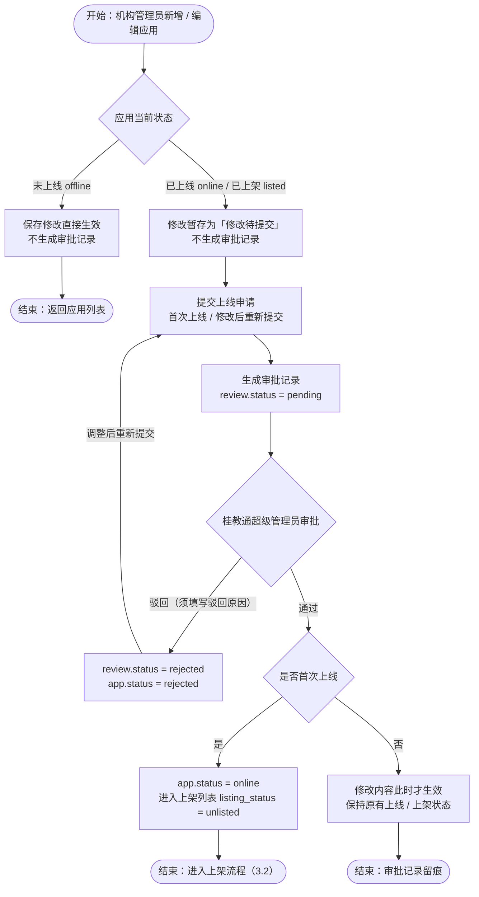
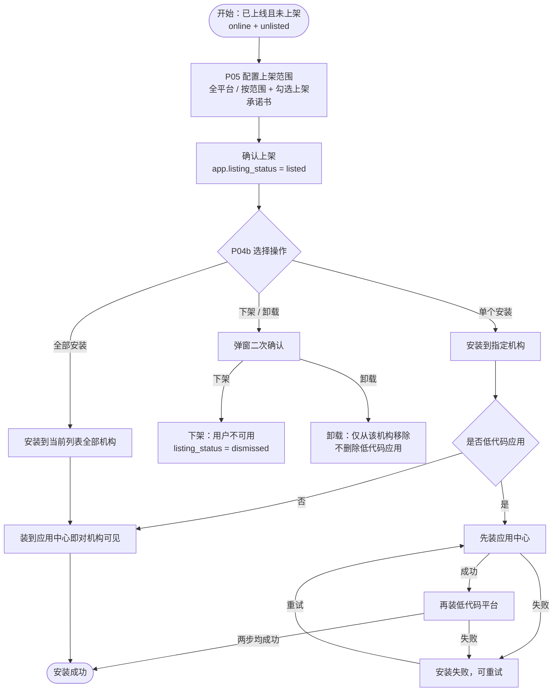
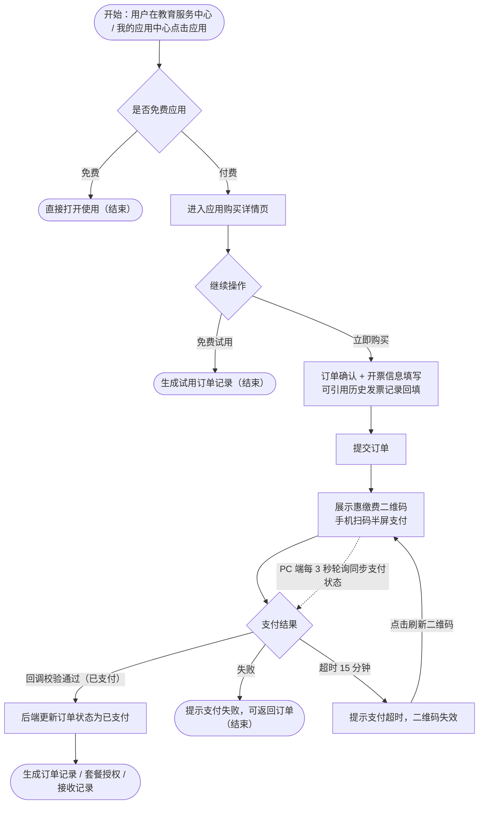

# 应用中心重构 - 产品需求文档

> 版本：v2.0
> 状态：初稿
> 基于 design.md v2.0

| 版本 | 日期 | 修订人 | 修订说明 | 状态 |
|------|------|--------|----------|------|
| v2.0 | 2026-07-17 | 孙美 | 重写：适配 design v2.0（范围改名、分类管理重构、审批管理重构、删除共享功能、补充 4 个状态机） | 初稿 |

---

## 一、文档概述

本文档为应用中心重构的产品需求规格说明，面向多机构应用全生命周期管理平台，覆盖机构内应用申请→审批→上架→范围→安装、平台级应用监管与运营统计、教育服务中心集成以及订单管理的完整功能定义。

## 二、范围

### 2.1 建设范围

| 模块 | 包含功能 |
|------|---------|
| 应用管理 | 应用申请管理、应用上架管理、全平台应用（超管专属）、上架范围管理、应用分类管理、应用审批管理、标签管理 |
| 平台管理 | 应用统计 |
| 订单管理 | 订单套餐授权管理、订单记录管理（应用购买的订单）、试用套餐记录管理、应用套餐配置 |
| 门户端 | 教育服务中心（P21 我的空间 / P22 桂教通门户）、应用详情与付费购买（P22 页内视图）、我的空间、我的应用中心、我的订单 |
| 移动端门户 | 首页（一级分类 → 二级分类 → 应用三层网格，系统分类内联展开、自定义分类「更多」开新界面）、应用（分类浏览）、班级、消息、我的 |

### 2.2 明确不做

- 实体商品购物车功能（从原商城页面移除）
- 商城支付流程改造（保持商城现有支付流程不变）
- 库存管理、对账结算

## 三、业务流程

### 3.1 应用上线申请审批流程

此处管理员指的是桂教通超级管理员，只有桂教通超级管理员具有审批权限。机构管理员新增应用、修改应用、上线申请、桂教通超级管理员审批、结果归档五个环节。应用未上线时修改直接生效、不产生审批流程；已上线或已上架应用的修改需重新提交上线申请，审批通过后才生效。

1. 机构管理员在应用申请管理页对已创建但未上线（app.status = offline）的应用提交上线申请。提交前确认应用基本信息完整，提交后系统生成一条审批记录（review.status = pending）。此时应用不可编辑基本信息。
2. 桂教通超级管理员在审批列表的"待审批"Tab 中看到该记录，查看应用详情后选择"通过"或"驳回"。通过后 app.status 变为 online，应用进入机构管理员的应用上架管理列表（P04），状态为未上架（listing_status = unlisted）；驳回时需填写驳回原因，review.status 变为 rejected，app.status 变为 rejected（已驳回）。
3. 审批通过后应用可进入上架流程。审批驳回后回到上线申请人，修改后可重新提交上线申请（重新提交时 app.status 回到 offline、列表展示待审批）。审批记录永久保留。
4. 已上线 / 已上架应用的修改：机构管理员在 P02 修改已上线（online）或已上架（listed）应用的信息并保存时，系统仅标记为「修改待提交」，不生成审批记录；用户再次点击「提交上线申请」后才生成审批记录（审批记录类型标记为"修改"）。审批通过后修改内容才生效，应用保持原有上线 / 上架状态，不重复进入上架列表；审批驳回时修改不生效，可调整后重新提交。未上线（offline）应用的修改保存后直接生效，不进入审批流程。
5. 修改待提交期间，列表状态标签显示"修改待提交"，操作列提供"提交上线申请"；提交后状态标签显示"修改待审批"，审批通过或驳回后恢复为应用本身的上下线状态。

审批期间网络中断时，当前审批结果不落库，已填写意见保留并允许重试。

下线为独立路径，不经过审批：应用创建人或管理员对 app.status = online 且 app.listing_status = unlisted 的应用点击"下线"，弹窗确认后直接变为 offline；已上架（listing_status = listed）的应用不允许下线，按钮直接隐藏。

### 3.2 应用上架及安装流程

管理员上架应用、配置范围、安装三个环节。

1. 管理员对已上线（online）且未上架（unlisted）的应用发起上架，进入 P05 配置上架范围（全平台/按范围），勾选上架承诺书后确认，app.listing_status 变为 listed。点击任意上架范围进入 P04b：单个安装为安装到对应机构，全部安装为安装到当前列表所有机构，卸载/全部卸载同理。
2. 安装：非低代码应用只装到应用中心即对机构可见；低代码应用跨机构安装同此流程，不跨机构需先装应用中心（失败则「安装失败」可重试），成功后再装低代码平台（失败同样「安装失败」可重试），两步均成功才算安装成功。
3. 下架和卸载均需二次确认。下架后用户无法使用，卸载仅从指定机构移除，不删除低代码应用。已上架的应用不允许直接下线，必须先下架方可下线。

### 3.3 应用付费购买流程

用户在教育服务中心或我的应用中心点击应用：免费应用直接打开使用；付费应用打开详情界面，可试用时显示「免费试用」+「立即购买」，否则仅显示「立即购买」。
点击免费试用，生成一条试用订单记录；点击立即购买打开订单确认 & 开票信息填写界面，发票信息录入右上角提供"历史发票记录"入口，点击可查看当前人员历史发票记录，选择一条后自动回填至发票信息表单，也可手动填写发票信息；点击提交订单跳转到付费界面，展示跟惠缴费对接的二维码，手机扫码唤起惠缴费半屏支付，支付成功后PC端支付状态同步提示支付成功，支付失败则提示失败，同时出现返回订单的按钮点击返回我的订单界面。PC 端支付状态同步机制：惠缴费完成支付后通过异步回调通知平台后端（回调含签名校验、幂等处理），后端校验通过后更新订单状态为已支付，并触发订单记录、套餐授权、接收记录生成；PC 端支付界面每 3 秒轮询一次订单支付状态接口，检测到已支付即自动提示"支付成功"并进入成功页，检测到失败则提示失败并展示"返回订单"按钮，超过支付有效期（15 分钟，与二维码有效期一致）未支付则提示支付超时、二维码失效可点击"刷新二维码"；不做 WebSocket/SSE 服务端推送

## 四、详细需求说明

### （一）应用管理模块

本模块负责机构内应用的申请、上架、范围配置、分类管理和审批全流程，包含 12 个页面。

#### P01 应用申请管理页

页面由筛选区、结果列表和行内操作组成。筛选区提供应用名称、分类、状态的检索条件；列表按创建时间倒序排列，每页 20 条，展示应用关键信息和状态标签。

（1）查询和查看应用列表

用户进入页面后首先看到当前筛选条件下的应用列表，可以直接判断每条应用的上下线状态和基本属性。列表默认展示：应用 Logo（32×32 圆角图标）、应用名称（超 20 字符末尾截断，悬停显示全文）、应用ID（业务应用ID，置于应用名称之后）、应用openId（仅桂教通超级管理员列展示，置于应用ID之后）、应用分类（一级分类为主标，二级分类为副标灰字）、是否平台应用（平台型/非平台型，仅桂教通超级管理员列展示）、应用属性（完整属性文本，如"原生应用""原生应用/低代码应用""生态应用"）、适用机构（多值枚举展示，如"学校""教育局""超管后台"）、适用学段（多值徽标展示，仅适用机构包含学校时显示）、状态标签（已上线绿色徽标，待审批/修改待审批黄色徽标，修改待提交灰色徽标，已驳回红色徽标，未上线灰色徽标）。

- 修改筛选条件后点击"搜索"，列表按当前条件刷新；点击"重置"清空所有条件恢复默认视图。
- 查询无匹配数据时，列表区域显示"暂无应用"。
- 查询失败时列表区域显示"加载失败，请重试"和刷新按钮。

（2）新增应用

tenant_admin 可在任意状态下点击列表页右上角"新增应用"按钮，跳转 P02 应用申请编辑页（新建模式，底部按钮为"新建"）。

（3）上线应用

仅 app.status = offline 或 app.status = rejected（已驳回）的应用行显示"上线"按钮；已上线 / 已上架应用存在「修改待提交」标记时，操作列改为显示"提交上线申请"按钮。点击后进入 P02b 应用详情页（上线申请模式），页面底部呈现"确认上线"主按钮和"取消"次按钮。

点击"确认上线"前系统校验应用的 Logo、名称、分类等必填项是否完整。校验不通过时顶部红色提示"应用信息不完整，请先完善"，阻止提交。校验通过后系统生成一条审批记录（首次上线 review.type = 上线；存在待提交修改时 review.type = 修改），review.status = pending，review.applicant = 当前登录人；toast 在首次上线时为"上线申请已提交，待桂教通超级管理员审批"，在提交修改时为"上线申请已提交，修改信息待审批通过后生效"，返回列表页。

网络异常导致提交失败时，顶部红色提示"提交失败，请检查网络后重试"。

（4）管理应用

所有状态（已上线/未上线/待审批/已驳回）的应用行均显示"管理"按钮。点击后进入 P02b 应用详情页（管理模式），可查看凭证区和完整信息，并通过"修改"链接跳转 P02 编辑模式。

应用上线申请被驳回（app.status = rejected）或存在修改审批记录（修改待审批 / 已驳回）时，管理模式页面下方额外展示「审批信息」区，字段为：申请类型（上线/修改）、申请时间、申请人、审批人、审批时间、审批结果（驳回红色标签）、审批意见；审批意见缺失时展示"---"。

审批中的应用"管理"按钮不置灰，可正常点击进入 P02b 管理模式；编辑应用与更新 SuiteKey 不受审批状态限制，审批中亦可操作。

（5）下线应用

仅 app.status = online 且 app.listing_status = unlisted 时显示"下线"按钮。已上架（listing_status = listed）时该按钮直接隐藏。

点击"下线"弹出确认框"确定要下线该应用吗？"，确认后 app.status = offline，无需审批，不生成审批记录。下线失败时顶部红色提示"操作失败，请检查网络后重试"。

（6）查看应用（非管理员视图）

其他用户（非 tenant_admin）访问本页时，仅对 app.status = online 的应用行显示"查看"按钮。点击进入 P02b 应用详情页（只读查看模式），无任何操作按钮。

#### P02 应用申请编辑页

页面采用垂直单列表单布局，从上至下依次排列字段。所有标记 * 的字段为必填，未通过校验时对应字段红框提示并阻止提交。

（1）新建应用（新建模式）

从 P01"新增应用"入口进入，页面底部按钮为"新建"和"取消"。表单字段及其规则如下：

| 字段 | 必填 | 控件 | 规则 |
|------|:----:|------|------|
| 应用 Logo | * | 图片上传 | jpg/png/jpeg，推荐 140×140 圆角 24px，≤200KB；缺失提示"请上传应用 Logo"；格式/大小不符时在区域下方红字提示原因 |
| 应用名称 | * | 单行文本框 | 最大 20 字符，右侧实时显示"已输入字数/20"；超限禁止继续输入；名称在同机构内唯一，重复时字段下方红字"该应用名称已存在，请更换" |
| 应用简介 | * | 多行文本框 | 最大 100 字符，右下实时显示"已输入字数/100" |
| 所属分类 | * | 级联选择 | 先选一级分类，再级联选择对应二级分类 |
| 是否平台应用 | * | 单选 | 平台型 / 非平台型，默认选中非平台型；仅桂教通超级管理员展示且必填，机构管理员新增应用固定为非平台型（不展示此字段）。字段下方展示说明文案：平台型指的是不需要上架能用的应用，比如：桂教通门户；非平台型指的是需要上架使用的原生应用、生态应用等。 |
| 是否数据同步 | * | 单选 | 否 / 是，默认否 |
| 用户个人信息授权 | * | 单选 | 否 / 是，默认否 |
| 推送地址 | * | 文本框 | 仅是否数据同步=是时展示；校验格式为 http:// 或 https://，必填 |
| TOKEN | * | 只读文本框 | 仅是否数据同步=是时展示；点击右侧「随机生成Token」按钮生成 UUID，最大 50 字符，必填 |
| EncodingAesKey | * | 只读文本框 | 仅是否数据同步=是时展示；点击右侧「随机生成AesKey」按钮生成 32 字节 AES-256 密钥后 Base64 编码（去掉 = 填充），固定 43 字符，必填 |
| 打开方式 | * | 多选复选框 | PCweb / H5 / 独立小程序，至少 1 项 |
| 跳转登录限制 | * | 下拉选择 | 无需登录 / 仅持有账号登录 / 可注册或登录，必填 |
| 适用机构 | * | 多选复选框 | 学校 / 教育局 / 超管后台，至少 1 项；「超管后台」仅桂教通超级管理员登录时展示该选项 |
| 适用学段 | * | 单选+多选 | 范围模式为单选（所有学段/部分学段，默认所有学段）；仅适用机构含"学校"时展示与校验；选"部分学段"时下方展开学段多选：幼儿园/小学/初中/高中/中职/高职/本科/研究生，支持多选，至少 1 项 |
| 应用详情介绍 | * | 富文本编辑器 | 支持粗体/斜体/下划线/删除线/引用/代码/列表/字号/颜色/对齐/超链接/图片/视频/清除格式；占位提示"请上传应用图文介绍、操作文档、演示视频…"；≤5MB HTML；必填 |
| 应用视频介绍 |   | 上传组件 | 附件上传，支持多选，accept="video/*"，最多 5 个视频，单个 ≤10MB |
| 应用属性 | * | 级联选择 | 一级：原生应用/生态应用（默认原生）；选原生应用时级联二级：低代码应用/自建应用 |
| 应用ID | * | 单行文本框 | 仅应用属性=低代码应用时展示；输入低代码应用ID，必填，缺失提示"低代码应用请填写应用ID" |
| 可见性-移动端角色 | * | 多选 | 仅打开方式含独立小程序时展示；10 类角色：教育局职工/学生/学校教职工/家长/毕业生/退休教职工/临时成员/公共账号/开发者/访客，至少 1 项；当前登录角色为桂教通超级管理员时额外展示「平台管理员」选项，可勾选 |
| 可见性-移动端地址 | * | 前缀下拉+文本框 | 仅打开方式含独立小程序时展示，展示时必填；前缀下拉选择 http/https，文本框填写域名或路径，地址最大 500 字符（不含前缀） |
| 可见性-微信 appid | * | 文本框 | 仅打开方式含独立小程序时展示，最大 64 字符 |
| 可见性-PC 端角色 | * | 多选 | 仅打开方式含 PCweb 时展示；同移动端角色枚举（含访客；仅桂教通超级管理员登录时额外展示平台管理员），至少 1 项 |
| 可见性-PC 端地址 | * | 前缀下拉+文本框 | 仅打开方式含 PCweb 时展示，展示时必填；前缀下拉选择 http/https，文本框填写域名或路径，地址最大 500 字符（不含前缀） |
| 可见性-H5 角色 | * | 多选 | 仅打开方式含 H5 时展示；同移动端角色枚举（含访客；仅桂教通超级管理员登录时额外展示平台管理员），至少 1 项 |
| 可见性-H5 地址 | * | 前缀下拉+文本框 | 仅打开方式含 H5 时展示，展示时必填；前缀下拉选择 http/https，文本框填写域名或路径，地址最大 500 字符（不含前缀） |
| 白名单配置 |   | 地址输入区（前缀下拉+输入框+添加按钮）+ 标签列表回显区 | 默认根据已填写的移动端/PC端/H5 地址自动回填（蓝色标签展示完整地址，标签带删除按钮，删除后不再自动回填展示）；手动添加改为输入区：前缀下拉 http/https + 地址输入框 + 「添加」按钮（输入框回车亦可提交），添加后与自动回填项统一以标签列表展示在输入区下方，标签可点击 × 删除；点击标签进入修改态：该地址回填到输入区，按钮变为「保存修改」并出现「取消」，保存后原位更新（重复校验排除自身），默认回填项被修改后转为手动项；列表头部展示「已添加 n/20」计数；地址支持 * 通配符（每条最多一个，如 https://*.example.com 匹配该域名下全部子域名；单独一个 * 如 https://* 表示匹配全部地址）；重复地址去重；最多 20 条（含默认回填），达到上限禁用添加按钮（修改态不受限）；字段下方展示两行提示：「配置的是本应用需要打开的域名地址，不配置应用无法打开」「支持 * 通配符：https://*.example.com 匹配该域名下全部子域名，https://* 匹配全部地址；最多 20 条（含默认回填）」 |
| 查看接入文档 |   | 链接 | 蓝色文字链接，点击新窗口打开接入文档 URL |

点击"新建"触发全量校验，未通过时页面滚动定位到首个错误字段。校验通过后写入 app 记录，系统自动生成 app.system_suite_id（当前最大应用ID +1，全局唯一，不可修改）与 app.system_suite_key）与应用 openId（app.app_open_id：非低代码应用生成长度 15 的英文/数字/下划线串，低代码应用取填写的低代码应用ID），返回 P01 列表。toast 提示"应用创建成功"（新建仅创建应用，上线申请由 P01「上线」按钮触发，不在此处生成审批记录）。

- 单字段失焦触发即时校验（Logo/名称/简介/分类/打开方式/机构/学段/属性/suiteID）。
- 网络异常时已填写内容通过 localStorage 保留 24 小时。
- 网络异常提交失败时顶部红条"提交失败，请检查网络后重试"。
- 若表单未修改直接点击"取消"，直接返回来源页；若已修改，弹出二次确认"当前编辑未保存，确认离开？"。

（2）编辑应用（编辑模式）

从 P02b 应用详情页的"修改"链接进入，字段按当前值回填，底部按钮为"提交"和"取消"。

提交时全量校验必填项。校验通过后按应用当前状态分流处理：

- **未上线（app.status = offline）**：修改内容直接覆盖写入 app 记录（app.system_suite_id 不变），立即生效，**不生成审批记录**，toast 提示"保存成功"，返回 P01。
- **已上线（app.status = online）或已上架（listing_status = listed）**：修改内容暂存为「修改待提交」，**此时不生成审批记录**，应用原信息继续对外展示；列表状态标签变为"修改待提交"，操作列出现"提交上线申请"按钮，toast 提示"修改已保存为待提交，请重新提交上线申请，审批通过后生效"，返回 P01。
- **提交上线申请（P02b 上线申请模式下点击「确认上线」）**：此时才生成审批记录（review.type = 修改，review.status = pending），状态标签变为"修改待审批"，toast 提示"上线申请已提交，修改信息待审批通过后生效"。

> 修改生效规则：审批通过前，对外（门户端、机构管理员应用上架管理等）仍展示修改前的旧值；审批通过后系统将暂存的修改内容合并生效，应用保持原有上线 / 上架状态，不重复进入上架列表（listing_status 不变）；审批驳回时修改内容不生效、不清除，机构管理员可调整后重新提交。

#### P02b 应用详情页

页面由面包屑、头部凭证区、基本信息区（上线申请模式下基本信息区下方嵌入「上线配置」区，二者同属一个模块）和底部操作区组成。根据进入入口分为四种模式：管理模式（P01"管理"进入，全部状态应用，应用上线被驳回时展示审批信息）、上线申请模式（P01"上线"进入，offline 或 rejected 应用）、只读查看模式（P01 其他用户"查看"进入）、审批详情模式（P10"详情"进入）。

（1）查看头部凭证区

| 展示项 | 字段 | 形式 |
|-------|------|------|
| 应用 Logo | app.logo | 大尺寸圆角图标，与凭证区左右布局 |
| 应用标题 | app.name + 分类拼接 | 加粗标题 |
| SuiteId | app.system_suite_id | 标签+值两栏，纯只读，全局唯一不可修改 |
| SuiteKey | app.system_suite_key | 标签+值两栏 + 右侧"复制"链接按钮 |

管理模式、上线申请模式显示 SuiteKey「复制」链接；只读查看、审批详情模式展示凭证区但不显示「复制」。凭证创建应用时生成，只读不可更新。

（2）复制 SuiteKey

点击 SuiteKey 右侧"复制"链接，系统将 app.system_suite_key 值写入剪贴板，toast 提示"SuiteKey 已复制"。复制失败（如浏览器权限限制）时 toast 红色提示"复制失败，请手动复制"，页面无其它变更。

（3）查看基本信息区

板块标题为"基本信息（修改的信息需要重新提交上线申请，审批通过后生效）"，右侧提供"修改"链接按钮（仅管理模式显示）。点击"修改"跳转 P02 编辑模式，字段全部回填。应用存在「修改待提交」或「修改待审批」标记时，标题下方展示提示条：待提交时说明"当前修改已保存为待提交，尚未生成审批信息，请重新提交上线申请，审批通过后修改才会生效"并提供「立即提交上线申请」入口；待审批时说明"修改信息正在审批中，审批通过后自动生效，审批通过前按原信息展示"。

基本信息区按 P02 字段分组只读展示：基础信息（Logo 大图/名称/介绍/分类）、打开方式（中文全称，顿号分隔）、跳转登录限制、适用范围（mode=all 显示"所有学段"）、详情介绍（富文本滚动）、应用视频（无则隐藏）、应用属性（生态应用附 suiteID）、数据与授权（数据同步=是时展示推送地址/TOKEN/EncodingAesKey）、收费与可见（按打开方式展示移动端/PC/H5 角色+地址+微信 appid；白名单默认回填三地址、最多 20 个且支持 * 通配符）。只读字段统一以「标签：值」展示，标签后带中文冒号；超长名称截断悬停，介绍富文本自带滚动。

（4）底部按钮

所有底部按钮居中显示。

**管理模式**：仅显示"返回"按钮，操作通过头部 SuiteKey「更新」与基本信息区「修改」入口执行。

**上线申请模式**：应用基本信息区下方（同一模块内）新增可编辑「上线配置」区，提交/返回按钮统一置于模块最下方，显示「提交」（主）+「返回」（次）。点击"提交"前系统核对应用必填字段完整性及上线配置必填项，且须勾选上架承诺书（未勾选时"提交"置灰）；缺项时顶部红色提示"应用信息不完整，请先完善"，阻止提交。校验通过后系统生成 review 记录：首次上线 review.type = 上线；应用存在「修改待提交」内容时 review.type = 修改。review.status = pending，toast 分别为"上线申请已提交，待桂教通超级管理员审批"与"上线申请已提交，修改信息待审批通过后生效"，返回 P01 列表。桂教通超级管理员提交时不生成审批记录（审批为其专属操作），直接置 app.status = online，toast「上线成功」，返回 P01 列表。

上线配置区（上线申请模式）字段及显示逻辑：
- 是否跨机构（radio 是/否，*）：仅低代码应用展示；桂教通超级管理员选"是"时联动展示跨机构层级与所属机构，机构管理员选"是"时不展示这两项。
- 跨机构层级（radio 厅/市/区县，*）：仅桂教通超级管理员 + 低代码应用 + 是否跨机构=是 时显示。
- 所属机构（可搜索多选输入框，*）：仅桂教通超级管理员 + 低代码应用 + 是否跨机构=是 时显示；根据输入机构名称模糊搜索（最多查询 50 条），支持多选；数据来源按跨机构层级获取——层级为厅→获取所有教育行政部门，为市→获取所有市级教育行政部门，为区县→获取所有区县教育行政部门；跨机构层级切换时清空已选并重新加载候选。
- 收费方式（radio 收费/免费，*）：仅非低代码应用展示；选"收费"时联动展示是否可试用、试用套餐、授权套餐。
- 是否可试用（radio 是/否，*）：仅非低代码应用 + 收费方式=收费 时显示；选"是"时展示试用套餐。
- 试用套餐（下拉，*）：仅非低代码应用 + 收费方式=收费 + 是否可试用=是 时显示。
- 授权套餐（下拉多选，*）：仅非低代码应用 + 收费方式=收费 时显示；数据来源应用套餐配置（套餐管理），可多选多条套餐。
- 版本号（下拉搜索框，单选）：仅低代码应用展示；是否跨机构 = 否 时必填（*），是否跨机构 = 是 时非必填；按当前低代码应用ID远程获取版本列表，未获取到则提示"需要上架应用到低代码应用市场"。
- 上架承诺书（checkbox，必勾选）：文案与免责声明弹窗同 P05（禁止点遮罩关闭，仅「我知道了」关闭）；未勾选时「提交」置灰。

该应用已被删除或不属于当前机构时，页面顶部提示"应用不存在或无查看权限"，隐藏所有操作按钮。

（5）查看审批信息

审批详情模式：展示当前应用最近一条上线审批记录（申请类型、审批状态徽标、申请人/时间、审批人/时间、审批意见；字段同 P11v），无记录时整块隐藏。管理模式在 app.status = rejected（上线申请被驳回）或存在修改审批记录（修改待审批 / 修改被驳回）时展示最近一条对应记录，字段相同；其余状态不展示。

#### P04 应用上架管理页

页面由筛选区、结果列表和行内操作组成。

（1）查询上架应用列表

筛选栏提供应用名称、应用分类、上架范围（下拉，本机构的范围列表）。点击"搜索"按条件刷新列表；点击"重置"清空条件恢复默认视图。

列表按创建时间倒序，每页 20 条，展示：应用 Logo、应用名称、应用分类（一级/二级）、是否平台应用（平台型/非平台型，仅桂教通超级管理员列展示）、开发者名称、应用属性（完整属性文本，如"原生应用""原生应用/低代码应用""生态应用"）、上架范围（仅展示上架时「范围选择」所选内容：选择全平台则展示"全平台"，选择按范围则展示所选范围名称，以英文逗号隔开；不展示分享范围。每条范围均为超链接、可单独点击进入对应范围的 P04b 应用安装列表）、创建时间、上架状态（已上架/已下架/未上架标签）。

> 上架记录规则同 P05：一次上架只生成一条记录，上架范围列仅聚合「范围选择」内容、不含分享范围，各范围可点选进入 P04b。

（2）上架应用

listing_status = unlisted 或 dismissed 且 app.status = online 的应用行显示"上架"按钮。点击进入 P05 应用上架配置页。

> 上架范围与分享范围规则见 P05（含学校机构、分享来源、动态引用）。

> 已下架（dismissed）应用重新上架时，保留原上架范围：P05 的上架范围默认回填该应用下架前的上架范围配置，管理员可在此基础上调整，确认后直接进入 listed，不丢失原范围设置。

（3）下架应用

仅 listing_status = listed 时显示"下架"按钮。点击弹出确认框"确认要下架 XXX 吗？下架后全区用户将无法使用此应用，已安装的应用不会被卸载"。确认后 listing_status = dismissed（已下架），仅使应用从范围不可见，不卸载已安装的应用。

> 分享来源应用规则：其他机构分享过来的应用，若分享方在「应用分享管理」中停止分享当前应用，被分享方侧该应用自动变为已下架（listing_status = dismissed），且**不允许重新上架**；该行"上架"按钮仍在，点击时 toast 错误提示「【分享应用的机构名称】已经停止分享当前应用，当前应用不能上架。」，不进入 P05。已安装应用不卸载。
>
> 停止分享范围含**桂教通平台**时规则一致：桂教通平台侧该应用同样自动下架且不可重新上架，点击"上架"提示同上（机构名称取该应用的分享方机构）。

P04 页面顶部以两个 Tab 组织：**应用上架管理**（见上）与**应用分享管理**（当前机构分享给其他机构 / 桂教通平台的应用）。

（4）应用分享管理

展示当前机构已分享给其他机构或桂教通平台的应用，分享范围于上架时记录。

筛选栏提供应用名称、应用分类（下拉）、是否平台应用（下拉：平台型/非平台型）。点击"搜索"按条件刷新列表；点击"重置"清空条件。

列表展示：应用 Logo、应用名称、应用属性（展示应用类型内容，原生应用/生态应用 + 低代码应用/自建应用等）、应用分类（应用对应的分类）、分享范围（记录上架时分享范围，桂教通平台及每个被分享机构均逐一列出，如"桂教通平台、南宁市第一中学、柳州市高级中学、桂林市育才小学、北海市实验学校、玉林市第一初级中学、梧州市实验小学"）、分享时间、操作（停止分享）。

停止分享：点击行内"停止分享"弹出"停止分享"弹窗。弹窗内"停止分享范围"按两类友好承载大量机构，且**至少选择一项（必填）**：
- **桂教通平台**：该应用当前分享至桂教通平台时以勾选框展示，旁注"停止后平台侧该应用下架且不可重新上架"；
- **其他机构**：仅列出该应用已分享的机构，以「搜索框 + 固定高度 220px 滚动复选列表」展示，支持按机构名称实时搜索、全选当前筛选结果、清空已选；列表上方实时展示「已选 X / 共 N 个，单次最多 200 个」。

分享限制最多 200 个机构，因此**单次停止分享同样最多 200 个机构**：勾选超出时保留前 200 个并提示「单次最多停止分享 200 个机构，已保留前 200 个」，提交时超过 200 提示「单次最多停止分享 200 个机构，请分批操作」。

提交后：按所选停止分享范围（机构 / 桂教通平台），将对方侧应用上架管理列表中的该应用下架（若已上架则改为已下架 dismissed，若未上架则保持未上架）；已安装应用不卸载。所选停止分享范围覆盖全部后，该应用从分享列表移除。停止分享给机构或桂教通平台后，对方侧（对应机构 / 桂教通平台）该应用均不可重新上架，点"上架"时提示「【分享应用的机构名称】已经停止分享当前应用，当前应用不能上架。」

#### P04b 应用安装列表页

由 P04 上架范围超链接进入，面包屑为"应用上架管理 / 安装列表（{范围名称}）"，展示所选范围覆盖的全部机构。页面根据当前应用的应用属性自动展示对应的安装流程说明（原生应用 / 低代码应用），不再提供手动切换。

（1）查询和查看机构安装状态

筛选栏提供机构名称、机构 ID、安装状态（安装成功/安装失败/未安装）查询，按钮包含"搜索""重置""全部安装""全部卸载"。

列表展示：机构名称、机构 ID、机构类型（教育局机构/学校）、所在城市、安装状态（三态标签：安装成功、安装失败、未安装）、安装失败原因（仅安装失败展示具体失败原因，其余显示"—"）。默认按机构名称升序排列，每页 20 条。

安装流程见 3.2：原生应用仅装到应用中心；低代码应用需应用中心 + 低代码平台两步均成功，任一步失败即为安装失败并可重试。

（2）单机构安装/卸载

- 行尾"安装"按钮（仅未安装机构显示）或"重试"按钮（仅安装失败机构显示）。点击弹窗提示"是否确认将【应用名称】应用在【机构名称】安装？"，确认后安装成功，toast 提示"安装成功"。
- 行尾"卸载"按钮（仅已安装机构显示）。点击弹窗提示"是否确认将【应用名称】应用从【机构名称】卸载？"，确认后卸载成功，toast 提示"卸载成功"。

（3）全部安装/卸载

- "全部安装"按钮：弹窗"是否确认将【应用名称】应用安装到全部机构/学校？"，确认后后台执行全量安装任务，toast"已提交全部安装"。
- "全部卸载"按钮：弹窗"是否确认将【应用名称】应用从所有机构/学校卸载？"，确认后后台执行全量卸载任务，toast"已提交全部卸载"。

#### P05 应用上架配置页

由 P04「上架」按钮进入，页面分为应用基本信息区（只读）与上架配置区（范围选择 + 分享范围）；底部居中「取消」「确认上架」，须勾选上架承诺书后方可提交（未勾选时按钮置灰）。

应用基本信息区完整展示 P02b 管理模式全部字段（凭证区 SuiteId/SuiteKey 只读，基本信息全字段），字段标签后带中文冒号，隐藏「更新」「修改」链接与操作按钮。

| 字段 | 控件 | 必填 | 规则 |
|------|------|:----:|------|
| 范围选择 | radio 全平台/按范围 | 机构管理员必填 | 桂教通超管：是否跨机构=否时可全平台/按范围，=是时仅按范围；机构管理员：全平台/按范围均展示（低代码/非低代码），全平台=上架到本机构及所有下级机构并自动安装到应用中心；当前机构为学校时不展示，默认本校。按范围为可搜索下拉多选，数据源为本机构上架范围管理。 |
| 分享范围 | checkbox 桂教通平台/其他机构 | 学校机构必填 | 仅机构管理员展示（低代码/非低代码）；勾选「其他机构」联动「其他机构」下拉选择器：精确搜索（须输入完整机构名称才能检索到该机构）、查询范围为全平台机构数据（不限当前机构管辖范围）、可多选、最多分享 200 个机构；下拉框下方以只读文本区域按选择顺序回显已选机构名称（不可编辑）。学校机构至少选一项。当前机构为学校时，所选桂教通平台/其他机构会在超管与对应机构的应用上架管理各新增一条未上架记录。其他机构分享过来的应用不展示该字段（不可再分享）。 |

确认上架：勾选承诺书 checkbox（文案「我已仔细阅读并完全同意应用免责声明及上架承诺书，自愿承担一切相关法律责任。」，点击链接弹出免责声明弹窗）后「确认上架」可点击；确认后 app.listing_status = listed，toast「上架成功」，返回 P04。

**范围与记录规则**
- 上架范围为动态引用而非快照：机构/标签/范围增删后，已上架应用范围自动同步；仅移除机构时应用上架状态不变，该机构不再可见，已安装应用不卸载、无需重新审核。
- 一次上架无论选多少范围只生成一条上架记录；上架范围列聚合展示「全平台」或所选范围名称（英文逗号隔开），不含分享范围；各范围可单独点击进入 P04b。
- 低代码版本号已在 P02b 上线申请模式配置，本页不再选择。
- 学校机构：无范围选择，上架范围列展示本校及分享目标，记录在超管与对应机构生成，状态未上架；分享过来的应用上架后不生成分享记录。
- 分享来源应用：若分享方已停止分享当前应用（含停止分享给桂教通平台），被分享方（对应机构 / 桂教通平台）侧该应用保持已下架且不可重新上架，提交上架时提示「【分享应用的机构名称】已经停止分享当前应用，当前应用不能上架。」

#### P06 全平台应用页

桂教通超级管理员专属页面，跨机构查看**全平台已上架应用**并支持强制下架治理。仅超管可见（tenant_admin 不可访问）。菜单入口：应用管理 → 全平台应用。

（1）查询区

| 字段 | 控件 | 说明 |
|------|------|------|
| 应用名称 | 文本框 | app.name 模糊查询 |
| 应用分类 | 级联下拉 | app.category_id，一级→二级 |
| 应用ID | 文本框 | app.app_id 精确匹配（业务应用ID） |

按钮：搜索、重置。

（2）列表展示

数据范围：仅 `app.listing_status = listed` 的应用（跨全部机构）。列如下：

| 列 | 字段 | 备注 |
|----|------|------|
| Logo | app.logo | 圆角图标 |
| 应用名称 | app.name | — |
| 应用ID | app.app_id | 业务应用ID |
| 应用openId | app.app_open_id | — |
| 上架机构 | app.tenant_name | 关联带出 |
| 应用分类 | app.category | 级联路径（一级/二级） |
| 是否平台应用 | app.app_type | 平台型/非平台型 |
| 应用属性 | app.type + app.native_type | 拼接展示，如"原生应用/低代码应用" |
| 适用机构 | app.institution_scope | 多值 |
| 学段 | app.school_levels_mode + app.school_levels | 多值 |
| 状态 | app.listing_status | 展示为"已上架"标签 |
| 操作 | 强制下架 | 见下 |

（3）操作：强制下架

- 仅 `app.listing_status = listed` 行显示。
- 点击弹窗二次确认："确定要强制下架【{app.name}】吗？下架后该应用在【{app.tenant_name}】的上架列表将变为已下架状态，已安装的应用不卸载。"
- 确认后：
  - `app.listing_status = dismissed`（回到已下架）
  - 已安装应用不卸载（沿用机构下架规则）
  - 写入 OperationLog：`log.action = force_delist`、`log.operator_role = platform_admin`，detail 记录被下架应用、原上架机构、执行人
  - toast「强制下架成功」，列表刷新（该条因不满足 listed 条件被移出）
- 对应机构管理员在 P04 应用上架管理页看到该应用状态由"已上架"回落为"已下架"，分享到的其他机构对应的应用状态也改为已下架，被分享的机构在分享机构未上架前，不可上架，若分享的机构重新上架后分享范围有变更，以最新的分享范围为准，历史的范围如果不在新范围内的，将对应机构的应用删除，如如强制下架前分享给了A机构，重新上架后不分享A机构，则AI机构在对应的上架管理列表将删除该应用
- 取消：不变更。

（4）说明

- 本页不提供其他跨机构操作（无编辑、无审批、无上架），仅治理性下架
- 状态列固定展示"已上架"（因数据范围已过滤 listed），保留字段占位用于未来扩展

#### P07 上架范围管理页

页面顶部为两个 Tab 切换："自定义范围"和"默认范围"。

> 入口权限：当前机构为**学校**的机构管理员不展示「上架范围管理」菜单，P07 / P07a / P08 均不可进入；上架范围由教育局类机构管理员维护。

（1）查看自定义范围列表

展示本机构手动创建和维护的范围。

- 查询条件：范围名称（输入框）、类型（下拉：自定义/按教育机构/按标签），支持「查询」「重置」，按条件筛选列表。
- 列表列：范围名称（**蓝色字体、鼠标悬停显示手型指针，点击跳转「范围机构列表」页面（P07a）**）、范围 ID、范围类型（自定义/按教育机构/按标签）、范围摘要、创建时间、创建人。另有状态列（启用绿色标签/停用红色标签）和操作列（编辑 + 删除仅停用显示 + 停用/启用按钮合并在一列）。删除、启用、停用均需弹窗二次确认。
- 删除保护：被应用上架范围引用的范围不可删除。删除前校验该范围是否被已上架（listed）应用使用，被引用时提示"该范围已被 N 个应用的上架范围引用，不可删除"。

（2）查看默认范围列表

展示系统自动生成的范围（如教育局市场自动生成的默认范围），列表列：范围名称、范围 ID、创建时间。仅可查看，无编辑或管理操作。默认范围名称与机构名称一致（如：广西壮族自治区教育厅、南宁市教育局、南宁市青秀区教育局、横州市教育局、桂林市教育局等）。

**范围机构列表页（P07a）**

点击自定义范围列表中的「范围名称」跳转进入独立页面（P07a），展示当前范围内覆盖的全部机构，支持分页查询：
- 页面元素：返回按钮（回到 P07）、页面标题「范围机构列表」、当前范围名称展示。
- 查询条件：机构名称（输入框）、机构类型（下拉）、机构 ID（输入框），支持「查询」「重置」。
- 列表列：机构名称、机构 ID、机构类型。
- 分页：底部分页器（每页 10 条，支持翻页与总条数展示），查询条件变化后回到第 1 页重新分页。
- 操作按钮：查询区右侧提供「同步范围机构」按钮。点击后调用后端接口校验当前范围是否已包含该范围类型下全部机构：
  - 若未全部包含，后端自动将遗漏的机构补足到当前范围，前端刷新列表并提示「已同步范围机构，新增 N 个机构」；
  - 若已全部包含，提示「当前范围机构已完整，无需同步」。
- 动态引用说明：范围机构列表为**动态解析**结果（每次实时计算），机构新增/删除后由「同步范围机构」按钮（或标签联动）自动补齐/移除，使用该范围的应用上架范围同步更新。

#### P08 上架范围编辑页

由 P07 自定义范围 Tab 的"创建范围"或"编辑"按钮进入。页面标题根据模式动态显示"创建自定义范围"或"编辑自定义范围"，编辑模式下回填范围名称和类型。

（1）创建/编辑自定义范围

垂直单列表单，从上至下依次为：

| 字段 | 必填 | 控件与交互 |
|------|:----:|-----------|
| 范围名称 | * | 文本框，最大 50 字符 |
| 范围类型 | * | radio：自定义 / 按教育机构 / 按标签。切换时可见范围控件联动切换 |
| 可见范围 | * | 联动切换；自定义 / 按教育机构类型在下方以**只读文本区域**展示已添加内容（逐行展示，不可编辑）；按标签类型以 el-tag 展示已选内容（flex-wrap 自动换行，一行可展示多个），可关闭删除 |
| — 自定义 | * | 多行输入框 +「手动添加」+「批量导入」（type=primary 蓝色）。输入框支持输入多个 orgid，以英文逗号隔开，**单次最多添加 500 个**（超出提示「单次最多添加 500 个机构，请分批添加」）；点击「手动添加」去重后加入可见范围；「批量导入」弹窗支持下载模板、上传 .xlsx/.xls 文件。已添加机构在下方**只读文本区域按机构名称逐行展示**（按机构 ID 解析名称，解析不到时展示 ID），文本区域**分页获取数据，每页 500 条**，底部展示「共 N 个机构，每页 500 条」与翻页器 |
| — 按教育机构 | * | 下拉多选。数据源为**当前登录机构所管辖的下属教育局**（仅教育局层级，不含学校）；桂教通超级管理员为全平台教育局。选择后在下方**只读文本区域**逐行展示已选教育局名称，其下附说明「可见范围为当前选中教育机构及下级机构和学校」。当前机构下无下属教育局时下拉为空，并提示「当前机构下无下属教育局，无法按教育机构创建范围」 |
| — 按标签 | * | 下拉多选（数据源来自标签管理中的标签）。选择后在下方以 el-tag 标签展示，可关闭删除 |
| 不可见范围 |   | 输入框 + "添加"按钮。输入 orgid 点击"添加"后在下方以 el-tag 展示，可关闭删除；所有范围类型下均展示 |

保存后根据不同模式 toast「范围创建成功」或「范围编辑成功」，返回 P07。保存时校验范围名称不为空、可见范围不为空。编辑模式下至少保留一条可见范围。

> 保存后自动同步：范围保存后，使用该范围的应用，其上架范围自动同步更新（动态引用，无需重新上架）。范围为"按标签"类型时，后续标签中机构的增删自动反映到该范围，并继续同步到使用该范围的应用上架范围。

#### P09 应用分类管理页

页面由筛选查询区、"新增分类"按钮和树形列表组成。树形列表最多 2 级（一级→二级），一级和二级分类按层级展示。

（1）查看分类树

筛选条件为分类名称（模糊查询），点击搜索按钮刷新列表。树形列表每行展示：分类名称、分类编码、排序号、状态标签（启用绿色/停用红色）。行内操作按钮包括：添加下级（仅已启用一级分类显示）、编辑、启用/停用、删除（仅停用状态显示）。

同一层级按排序号升序排列，排序相同时按 id 最新优先。无匹配数据时显示"暂无分类"。

（2）新增分类（一级）

点击"新增分类"弹出表单：

| 字段 | 必填 | 控件 | 规则 |
|------|:----:|------|------|
| 分类名称 | * | 文本框 | 最大 30 字符 |
| 分类编码 | * | 文本框 | 最大 20 字符，仅限数字和英文；同一层级不可重复；输入时自动过滤非数字英文字符 |
| 排序 | * | 数字输入框 | 默认值 1 |

提交时校验名称和编码在同一层级不重复。校验通过后树刷新。

（3）添加下级分类

选中已启用的一级分类行，点击"添加下级"弹出表单：

| 字段 | 必填 | 控件 | 规则 |
|------|:----:|------|------|
| 上级分类 | * | 只读文本 | 带出当前分类名称 |
| 分类名称 | * | 文本框 | 最大 30 字符 |
| 分类编码 | * | 文本框 | 最大 20 字符，仅限数字和英文；同一层级不可重复 |
| 排序 | * | 数字输入框 | 默认值 1 |

提交时校验名称和编码在同一层级不重复。最多可建 2 级分类，二级分类下不再显示"添加下级"入口。

（4）编辑分类

点击"编辑"弹出表单，弹窗回填分类名称、编码（禁用）、排序。

- 一级分类：只可修改分类名称和排序，编码不可修改。
- 二级分类：除分类名称、排序外，额外展示「上级分类」下拉（默认带出当前所属一级分类），可修改归属的一级分类。下拉仅可选已启用的一级分类（当前上级已停用时仅展示原值、不可改选其他停用分类）；变更后该二级分类从原一级分类下移出并挂到所选一级分类下，且名称与编码在所选一级分类下不可重复（重复时提示"该上级分类下名称或编码已存在"）。

（5）启用/停用分类

- 点击"停用"弹窗二次确认"停用后，当前分类及下级分类将停用，请确认是否停用"，确认后当前及所有下级 status = disabled。
- 点击"启用"弹窗二次确认"启用后，当前分类及下级分类将启用，请确认是否启用"，确认后当前及所有下级 status = enabled。

停用规则：已停用分类在已使用场景中展示正常——应用列表的分类展示、分类筛选（筛选条件中仍可选该分类）、应用详情中的分类展示均不受影响；仅在应用新增（选择所属分类）时不展示已停用分类。

（6）删除分类

仅已停用（status = disabled）的分类行显示"删除"按钮。已启用分类不显示删除按钮。

删除限制：已被应用使用的分类不可删除；存在下级分类的分类不可删除（需先删除其下级分类，且下级分类均无应用使用）。

满足删除条件时，点击"删除"弹窗二次确认"数据删除后，无法找回，请确认是否继续删除？"，确认后删除该分类。

#### P10 应用审批列表页

页面顶部 Tab：待审批 / 已审批。筛选：应用名称（模糊）、应用分类（级联一级/二级）、应用 ID（精确），支持搜索/重置；条件变化回到第 1 页。

列表字段复用 P01（1）：Logo、名称、ID、分类、属性、是否平台应用、机构名称（替代开发者名称）、申请时间、类型标签（上线/修改），不含操作列；按申请时间倒序、每页 20 条。已审批 Tab 附加审批时间、审批结果标签（通过绿/驳回红）、审批人。

操作列：待审批 Tab 仅 pending 显示「审批」，任意状态可「查看」；已审批 Tab 仅「查看」。

#### P11 应用审批操作页（审批模式）

由 P10 待审批 Tab 行尾"审批"按钮进入。页面分两张卡片：上方卡片展示应用完整信息（全部只读），下方卡片展示审批操作区。底部按钮居中。

（1）查看应用信息（上方卡片）

应用详情区域与 P02b 管理模式一致（凭证区、基础信息、打开方式、登录限制、适用范围、详情介绍、应用视频、应用属性、数据与授权、可见性），全部只读，只读字段标签后带中文冒号；凭证区无更新按钮。

（2）审批操作（下方卡片）

| 字段 | 必填 | 控件 | 规则 |
|------|:----:|------|------|
| 审批结果 | * | radio | 通过 / 驳回 |
| 审批意见 |   | 多行文本框 | 最大 200 字符，show-word-limit；驳回时 * 必填，通过时非必填 |

- 驳回时校验审批意见不为空，通过时无需校验。
- 点击"提交"：审批结果=通过时 review.status = approved，app.status = online，应用进入机构管理员的应用上架管理列表（listing_status = unlisted），写入 reviewer 和 reviewed_at，toast「审批通过，应用已进入机构管理员上架列表（未上架）」；审批结果=驳回时 review.status = rejected，app.status = rejected（已驳回），review_comment = 审批意见，toast「已驳回」。
- 网络异常时结果不落库，已填写意见保留可重试。

#### P11v 审批详情页（查看模式）

由 P10 两个 Tab 的"查看"按钮进入。页面分两张卡片：上方卡片展示应用完整信息（同 P11 上方卡片完全一致），下方卡片展示审批信息只读。底部居中"返回"按钮。审批信息区布局同 P02b 管理模式的「审批信息」块：两列表单式，标签在左、值在右，字段宽度 50%、行高 32px；审批结果用 el-tag（通过绿色/驳回红色），驳回时审批意见红色高亮。

（1）查看应用信息（上方卡片）

同 P11 应用信息，展示全部字段（凭证区、基础信息、打开方式、范围、详情、视频、属性、可见性），只读字段标签后带中文冒号。

（2）查看审批信息（下方卡片）

| 展示项 | 字段 |
|-------|------|
| 申请时间 | review.created_at |
| 申请人 | review.applicant |
| 审批人 | review.reviewer（未审批时显示"---"） |
| 审批时间 | review.reviewed_at（未审批时显示"---"） |
| 审批结果 | review.status el-tag 标签（通过绿色/驳回红色），未审批时显示"---" |
| 审批意见 | review.review_comment（无时显示"---"） |

#### P12 标签管理页

标签用于范围可见范围的多维度配置，支持按自定义机构或按机构类型设定可见范围。

（1）查看标签列表

展示所有标签：标签 ID、标签名称（蓝色字体、鼠标悬停显示手型指针，点击跳转「标签机构列表」页面（P12a））、标签类型（自定义标签/机构类型标签）、关联范围数量。无标签时显示"暂无标签"。

（2）新建标签

点击「新建标签」进入 P12e 标签编辑页（新建/编辑同界面），字段如下，保存后返回 P12：

| 字段 | 必填 | 控件 | 规则 |
|------|:----:|------|------|
| 标签名称 | * | 文本框 | 最大 50 字符，show-word-limit；同一名称不可重复 |
| 标签类型 | * | radio | 自定义 / 机构类型，切换联动下方可见范围 |
| 可见范围（自定义） | * | orgid输入框 + "添加" + "批量导入" | 输入 orgid 以英文逗号隔开，点击添加以 el-tag 展示；批量导入弹窗同范围。支持逐条关闭删除 |
| 可见范围（机构类型） | * | el-select 多选 | 数据源：省级教育行政部门、市级教育行政部门、区县级教育行政部门、直属事业单位、幼儿园小学、小学教学点、初级中学、高级中学、完全中学、九年一贯制、十二年一贯制、专门学校、特殊教育学校、大学 学院 独立学院、其他普通高教机构(分校、大专班)、高等专科学校、职工高校、职业高中学校、中等职业学校技工学校、高等职业学校 本科层次职业学院、开放大学培养研究生的科研机构、附设中职班残疾人中等学校、培训学校、研学基地(营地)、其他社会机构。多选后以 el-tag 展示，可关闭 |

**标签机构列表页（P12a）**

点击标签名称进入独立页面，结构与交互同 P07a：返回 P12、标题「标签机构列表」、当前标签名称；查询条件（机构名称/机构类型/机构 ID）、列表列（机构名称/机构 ID/机构类型）、每页 10 条分页均一致。差异：
- 操作按钮为「同步标签机构」，提示相应替换为「已同步标签机构，新增 N 个机构」/「当前标签机构已完整，无需同步」。
- 标签机构为动态解析，机构增删后由同步按钮或标签联动补齐/移除，并同步到引用该标签的范围及应用上架范围。

保存时校验名称不为空、名称不重复、可见范围不为空。

（3）修改标签

行尾"修改"按钮，弹窗回填标签名称、类型和可见范围，支持修改全部字段。

> 修改后自动同步：标签可见范围（机构）增删后，引用该标签的所有范围自动同步添加/移除对应机构，使用这些范围的应用上架范围同步更新（动态引用，无需重新上架）。

（4）删除标签

被范围引用的标签（关联范围数量 > 0）隐藏删除按钮，不可删除（删除前需确认是否被使用）。未被引用时可删除，弹窗二次确认后删除。删除后标签从关联范围可见范围自动移除（关联范围及应用上架范围同步变化）。

### （二）平台管理模块

本模块负责运营统计，包含 1 个页面。platform_admin、platform_operator 可访问并查看全平台统计数据；机构管理员（tenant_admin）可访问并查看本机构统计数据。

#### P17 应用统计看板页

页面从上至下分为：时间切换区、指标卡片区、图表区（三图一行）、排行榜区（两榜一行）、导出操作。

> 统计口径按角色区分：
> - 桂教通超级管理员（platform_admin）/ 平台运营员（platform_operator）：统计**全平台**数据，含平台应用和平台管理的机构应用（独立机构应用不计入）。
> - 机构管理员（tenant_admin）：统计**本机构**数据，即本机构创建/管理的应用及本机构范围内的使用数据。

（1）切换时间范围

时间切换以 el-radio-button 按钮组平铺展示：今日/本周/本月/本年，默认选中"今日"。切换后右侧联动展示时间范围描述，均展示各周期开始时间到当前时间的数据：

- 今日：0:00 ~ 当前时间
- 本周：周一 0:00 ~ 当前时间
- 本月：1 号 0:00 ~ 当前时间
- 本年：1 月 1 号 0:00 ~ 当前时间

（2）查看指标

4 张指标卡片 4 等分铺满内容容器，按角色区分口径：
- 超管（platform_admin / platform_operator）：应用安装数（平台应用安装成功数量，累计至当前）、平台应用数（超管上架应用总数，累计至当前）、活跃应用数（时间范围内至少打开一次的应用数）、应用使用人数（时间范围内至少使用一次平台任意应用的用户总数）。除活跃应用数、应用使用人数随时间切换变化外，其余卡片不随时间切换变化。
- 机构管理员（tenant_admin）：应用安装数（本机构范围内应用安装成功数量，累计至当前）、机构应用数（本机构上架应用数，累计至当前）、活跃应用数（本机构范围内时间范围内至少打开一次的应用数）、应用使用人数（本机构范围内时间范围内至少使用一次应用的用户总数）。

（3）图表区（三图一行等分）

三个图表卡片在同一行等宽展示，数据范围随角色切换（超管为全平台、机构管理员为本机构范围）：

- 应用点击量趋势：折线图，展示时段点击量累计与趋势。
- 分类统计：环形图，统计各分类的应用数。
- 活跃/非活跃应用占比：环形图，展示活跃与非活跃应用占比。

（4）排行榜区（两榜一行）

两个表格榜单在同一行展示，数据范围随角色切换（超管为全平台、机构管理员为本机构范围）：

- 用户数量榜 Top10：打开或点击过应用的用户数由多到少的应用
- 应用安装排行榜 Top10：安装数量由高到低的应用

（5）导出

点击右上角"导出"按钮，生成 1 个 Excel 文件（.xlsx），内含 6 张工作表，与页面各统计区块一一对应：

| 工作表 | 对应区块 | 字段 |
|--------|----------|------|
| 统计概览 | 指标卡片区 | 统计角色、统计范围、时间范围、应用安装数、平台应用数/机构应用数、活跃应用数、应用使用人数、导出时间 |
| 应用安装统计 | 应用安装数指标 | 应用名称、应用ID、是否平台应用（平台型/非平台型）、所属机构、应用分类（一级/二级）、安装机构数、安装数量（累计至当前）、最近安装时间 |
| 应用使用统计 | 活跃应用数/应用使用人数/点击量趋势 | 应用名称、应用ID、所属机构、活跃状态（活跃/非活跃）、使用人数（周期内）、使用次数（周期内）、点击量（周期内） |
| 应用分类统计 | 分类统计环形图 | 一级分类、二级分类、应用数、占比 |
| 用户数量榜 Top10 | 用户数量榜 | 排名、应用名称、用户数（周期内打开或点击过应用的用户数） |
| 应用安装排行榜 Top10 | 应用安装排行榜 | 排名、应用名称、安装数 |

导出规则：范围与时间同页面当前选择（口径见上）；文件名「应用统计_YYYY-MM-DD.xlsx」；需具备查看权限。

（6）数据实时性 / 刷新频率

统计采用"实时 + 准实时（分钟级）"混合模式，不做 T+1，所有指标在"今日"周期下即可查看当日数据：

- **刷新时机**：进入页面、切换时间范围（今日/本周/本月/本年）、切换角色时实时向后端拉取最新统计数据；页面提供「刷新」按钮，点击后重新拉取全部区块数据；不做自动轮询。
- **实时指标（秒级）**：应用安装数、平台应用数/机构应用数、应用分类统计、活跃/非活跃应用占比——基于应用/机构/上架等基础业务表实时聚合。
- **准实时指标（最长延迟 5 分钟）**：应用点击量趋势、应用使用人数、活跃应用数、用户数量榜 Top10、应用安装排行榜 Top10——基于点击/使用/安装行为流水，按 5 分钟粒度窗口汇总落库，页面展示最近一次聚合结果。
- **历史周期数据**：本周/本月/本年由日汇总表累加，已结算日期数据固定，当日部分按上述实时/准实时口径展示。
- **数据一致性**：同一时刻结构类与行为类指标可能存在最长 5 分钟时间差，属正常现象；导出数据与页面展示同源、口径一致。

### （三）订单管理模块

本模块负责订单套餐授权、订单记录（应用购买的订单）、试用订单和应用套餐配置管理，包含 5 个页面。

#### P18 订单套餐授权管理列表页

应用商品下单成功后生成对应的订单套餐授权记录。列表支持横向滚动（列较多）。

（1）查询授权记录

筛选栏：订单ID（模糊查询）、套餐名称（模糊查询）、业务套餐（下拉：全部/短信充值/存储容量充值/TOKEN充值/基座套餐/应用使用授权/应用试用授权）、所属机构（模糊查询）。列表展示：订单 ID、授权方式（自动/手动标签）、套餐名称、使用范围、业务套餐、有效期/天、分配大小、所属机构、购买用户 ID、到期时间、订单接收时间、授权状态（授权成功/未授权/授权失败标签）、授权状态描述。

> 授权状态、授权状态描述由订单记录列表迁移至此，与授权操作联动展示。

（2）手动授权操作

仅授权方式=手动的订单行显示操作按钮：

- **授权**（authStatus=pending 时显示）：点击弹窗二次确认「确认授权【套餐名称】吗？」，确认后授权成功，授权状态变为授权成功、授权状态描述变为已手动授权，toast「授权成功」；点击取消不变更。
- **取消授权**（authStatus=authorized 时显示）：点击弹窗二次确认「确认取消授权套餐：XXXX吗？取消后购买该套餐的用户将不可使用。」，确认后取消授权，授权状态变为未授权、授权状态描述变为等待手动授权，toast「已取消授权」；点击取消不变更。
- **手动授权**（授权方式=自动且 authStatus=failed 时显示）：自动授权失败的订单，操作列显示「手动授权」按钮；点击弹窗二次确认「自动授权失败，确认手动授权【套餐名称】吗？」，确认后授权成功，授权状态变为授权成功、授权状态描述变为已手动授权，toast「手动授权成功」；点击取消不变更。

（3）新增授权

列表页右上角提供主题蓝色「新增授权」按钮，点击弹窗，表单字段及顺序为：订单 ID、授权方式、业务套餐（下拉，必填）、套餐名称（下拉，根据所选业务套餐加载对应类型套餐，必填）、使用范围、有效期/天、分配大小、所属机构、购买用户 ID、到期时间、订单接收时间、授权状态、授权状态描述。除使用范围、分配大小、授权状态描述为选填外，其余字段均为必填。确认后新授权记录插入列表顶部。

#### P19 订单记录管理列表页

订单记录管理记录两类订单：①在桂教通平台购买的付费应用订单（教育服务中心/我的应用中心内嵌商城商品页下单）；②通过商城下单的订单（商城嵌入式页面/无痕下单）。列表列较多，支持横向滚动。

（1）查询和列表

筛选栏：订单 ID（模糊查询）、套餐名称（模糊查询）、购买用户 ID（模糊查询）、支付状态（下拉：全部/待支付/已支付/已过期/已取消/退款中/退款成功/退款驳回）。
列表展示：订单 ID、套餐名称、购买用户 ID、购买用户名称、购买所属机构、订单状态标签、购买类型（个人/机构）、订单接收时间。按接收时间倒序。

> 授权状态、授权状态描述已迁移至 P18 订单套餐授权管理列表页展示。

（2）查看订单详情与审批

点击行尾"查看"按钮（`onViewOrderReceive(r, 'view')`），以**新界面（子视图）**方式打开订单详情：列表视图与详情视图通过 `orderReceiveView` 切换，详情视图顶部提供"返回订单记录"按钮。详情采用 el-form / el-form-item 表单布局（同应用详情范式），包含三大信息区：

- **订单信息**：订单 ID（表单值）、付款状态（el-tag 标签）
- **商品套餐**：表单展示应用名称（**可点击跳转应用详情页**，按安装态显示购买/安装）、套餐名称、价格、购买类型（个人/机构）、数量、实付金额
- **发票信息**：发票类型、纳税人识别号、发票抬头、发票内容、单位名称、邮箱（无数据时显示"—"）

> 查看模式仅展示上述基础信息，**不展示任何审批信息**。

当状态为「退款中」、且点击操作列的"审批"按钮（`onViewOrderReceive(r, 'approve')`）时，同一新界面在发票信息区之后额外展示「审批操作」区：审批结果（el-radio：通过 / 驳回，必选）、审批意见（el-textarea，驳回时必填、通过时选填）；底部"提交审批"按钮。点击"提交审批"：审批通过 → 订单状态置为退款成功（触发原路退款），**对应应用回到购买前状态**：购买前已安装则保持已安装状态，未安装则保持未安装状态，不强制从「我的应用中心」移除，点击应用打开应用详情页（P22），根据状态展示购买/安装按钮；审批驳回 → 订单状态置为退款驳回（需填写审批意见），订单回退至已支付可重新发起退款。

列表操作列：状态为「退款中」的行在"查看"按钮之外额外显示"审批"按钮（点击以新界面方式打开订单详情，直接定位至审批操作区）。

#### P20 试用订单记录页

试用应用生成的订单记录列表。支持停用、延期和查看延期记录操作。

（1）查询和列表

筛选栏：试用机构名称（模糊）、用户名称（模糊）、状态（下拉：全部/使用中/已到期/停用）、试用期限（下拉：全部/7天/15天/30天/90天）。
列表展示：试用机构名称、用户姓名、手机号码、试用套餐、试用期限（天数）、开通时间、到期时间、延期说明、状态标签（使用中绿色/已到期红色/停用黄色）。列表列较多，支持横向滚动。

（2）停用操作

仅使用中状态的记录行显示"停用"按钮。点击弹窗二次确认"停用该账户后，将无法试用{{试用套餐}}，请确认是否继续操作？"，确认后状态改为"停用"，收回试用权限。停用的账号不可再申请延期。

（3）延期操作

仅使用中状态显示"延期"按钮，已到期和停用状态不显示。到期之前可延期，延期后恢复试用资格。点击"延期"弹出弹窗，包含以下字段：

| 字段 | 控件 | 说明 |
|------|------|------|
| 用户名称 | 只读文本框 | 自动带出 |
| 试用套餐 | 只读文本框 | 自动带出 |
| 开通时间 | 只读文本框 | 自动带出 |
| 到期时间 | 只读文本框 | 自动带出 |
| 试用期限 | 只读文本框 | 自动带出 |
| 延期时间 | el-date-picker * 必填 | 不能超过当前过期时间 + 试用期限（如过期时间 2025-12-31，试用期限 30天，则不能选超过 2026-01-30 的日期） |
| 延期说明 | el-input textarea | 最大 200 字符，选填 |

延期成功后：到期时间变更为新的延期时间，生成一条延期记录，延期历史中可见。

（4）查看延期

点击"查看延期"弹出弹窗，展示延期记录表格：用户姓名、延期操作时间、到期时间、延期说明。

#### P26 应用套餐配置列表页

（1）查询套餐

筛选栏：套餐名称、套餐编码、业务套餐（下拉）。列表展示：序号、业务套餐、套餐编码、套餐名称、价格、分配大小、计量单位、有效期(天)、基座套餐关联、是否手动开通业务。列表内容较宽，支持横向滚动。

（2）新建/编辑套餐

点击"新建套餐"或行内"编辑"进入 P26e 套餐编辑页（新增/编辑同界面），字段及联动规则如下：

| 字段 | 必填 | 控件 | 联动规则 |
|------|:----:|------|---------|
| 业务套餐 | * | 下拉 | 数据来源数据字典：短信充值/存储容量充值/TOKEN充值/基座套餐/应用使用授权/应用试用授权 |
| 套餐编码 | * | 文本框 | 常显；全局唯一校验 |
| 套餐名称 | * | 文本框 | 常显 |
| 价格(元) | * | 数字输入框 | 常显；必填 |
| 分配大小 | 条件必填 | 文本框 | 短信充值/存储容量充值/TOKEN充值类型时必填 |
| 计量单位 |   | 文本框 | 常显（如 G/条/资源点） |
| 有效期(天) | 条件必填 | 数字输入框 | 应用使用授权/应用试用授权/存储容量充值类型时必填 |
| 适用范围 |   | 文本框 | 常显；非必填。业务套餐为应用使用授权、应用试用授权时填写应用 ID |
| 基座套餐关联 | 条件必填 | 下拉多选 | 业务套餐=基座套餐时必填；数据源为已存在的套餐配置，可多选 |
| 套餐适用对象 |   | 下拉选择 | 字典：机构/个人 |
| 是否手动开通业务 | * | radio | 自动/手动 |

编辑时回填已有数据。底部按钮居中："取消"和"确定保存"。保存时校验必填项（含价格）、套餐编码全局唯一，并按业务套餐校验分配大小、有效期、基座套餐关联。

**编辑约束（被引用套餐）**：套餐被引用（订单套餐授权记录、订单记录、试用套餐记录、其他套餐的基座套餐关联、应用上架配置引用）时仍允许编辑，但**编辑仅影响新购**——保存后仅对之后新产生的订单/授权/试用按新配置生效；**历史订单沿用下单时的套餐快照**（下单时套餐名称、价格、分配大小、计量单位、有效期等字段已快照至订单），不受后续编辑影响；应用上架配置中引用的授权/试用套餐同样仅对新购生效。

（3）删除套餐

行内"删除"按钮：删除前校验套餐是否被使用，被使用的套餐不可删除并提示。判断"被使用"的引用来源：订单套餐授权记录、订单记录、试用套餐记录、其他套餐的基座套餐关联、应用上架配置（授权套餐/试用套餐）。未被使用的套餐弹窗二次确认后删除（提示"数据删除后，无法找回，请确认是否继续删除？"）。

#### P26e 应用套餐编辑页

由 P26「新建套餐」或行内「编辑」进入，标题动态展示「新建套餐」/「编辑套餐」，新建与编辑同界面，编辑时回填已有数据。字段、必填与联动规则同 P26（2）新建/编辑套餐；保存时校验必填项（含价格）、套餐编码全局唯一，并按业务套餐校验分配大小、有效期、基座套餐关联。底部按钮居中：「取消」「确定保存」。

### （四）门户端模块

本模块覆盖最终用户可见的教育服务中心、应用详情、应用购买。根据桂教通超管应用上架范围、试用学段、可见性配置来展示教育服务中心的应用

#### P21 教育服务中心页

> 教育服务中心（P21 我的空间 / P22 桂教通门户）由「轮播 Banner（桂教通服务中心）」与「成长服务范围」两个独立模块组成，模块下方为服务类型 Tab 与应用列表。轮播 Banner 两端均展示；**成长服务范围仅桂教通门户（P22）展示，我的空间（P21）不展示**。P21 我的空间-教育服务中心内容铺满容器宽度；P22 桂教通门户-教育服务中心保持 1200px 居中。

（1）浏览应用及打开

应用以卡片网格展示，每行 4 列。卡片展示：Logo、应用名称、收费类型标签（免费绿色/付费橙色角标）、应用简介摘要（截断 2 行约 60 字符，超出末尾省略号）。
点击应用，若已经安装，直接打开应用；若未安装或者需要购买，及打开应用详情界面。

（2）搜索与筛选

搜索条支持模糊搜索。分类筛选为一级分类下拉。无结果时显示"未找到相关应用"。

（3）进入详情

点击卡片打开应用详情（P22 页内视图）：免费应用展示「免费安装 / 立即打开」，付费应用展示授权套餐与「立即购买」。

#### P21-M 移动端门户页（Mobile）

面向机构管理员在移动端访问应用门户的场景，独立原型（`output/prototype/mobile.html`），与 PC 端教育服务中心并存，不改动 PC 端逻辑。

页面基于 390×844 视口设计，采用亮色主题（背景浅灰 #ECEDEF、分组卡片 #ffffff、主色蓝色系 #0A84FF）。底部 Tab 分为**首页、应用、班级、消息、我的**五个一级入口。

1. **首页（教师工作台，按教师端首页截图上下两屏还原）**：
   - 样式按教师端首页截图 1:1 还原：背景 #ECEDEF、分组卡片 #ffffff、主色 #0A84FF；顶部深蓝→蓝紫渐变平台栏内嵌白色圆角搜索框；快捷入口卡片 1px 蓝色描边、图标分列橙/青/绿/蓝；底部 TabBar 白色、激活项蓝色带红点。
   - 平台栏：平台标题「广西中小学智慧教育平台」与副标题「教师交流与教研活动」，其下为搜索框（占位「搜索应用 / 活动 / 资讯」）。
   - 快捷入口：一行 4 个（40×40 图标 + 名称，超出省略），共 12 个入口：学生专区、教师专区、高考专题、中考专题、家长专区、教师资格证、数智幼教、学平保险、心理健康、学习力测评、政务服务、艺术培训。
   - 待办通知：待办列表（红点 + 标题单行省略 + 相对时间），右上「更多」。
   - 常用应用：一行 4 个快捷入口（44×44 图标 + 名称，超出省略），右上「全部」跳转「应用」Tab。
   - 今日课程表：课程行（时间 + 班级·科目 + 地点），右上「更多」。
   - 活动专区：教师学科分布（学科名称 + 占比条形 + 百分比）与活动资讯（标签 + 标题两行截断 + 浏览数）。
   - 教师数据：教师总数 / 男教师 / 女教师 / 男女比例 / 平均年龄（示例 402 / 160 / 115 / 7:5 / 41）。
   - 页脚：主办单位信息「主办：广西壮族自治区教育厅 · 中国电信」。
2. **应用页**（原首页内容整体迁移，承载应用门户）：
   - 顶部为搜索框（支持应用名称、分类模糊搜索）。
   - 下方按一级分类分组成块，每块含分类标题（左侧分类色条 + 一级分类名称）与该分类下的应用网格。分类层级为**一级分类 → 二级分类 → 应用**。
   - 应用网格**每行固定 4 个**，每个应用仅展示 Logo 与应用名称（最多两行，超出省略）。
   - 每组**默认（收起态）跨二级分类取该分类下前 4 个应用，即一行**。
   - 标题右侧操作与展开方式按分组类型区分：

     | 分组类型 | 右侧操作 | 点击行为 |
     |---------|---------|---------|
     | 系统分类（协同管理/教务管理/智慧教育/教育工具/学生应用/自建应用） | 该分类应用数 > 4 时显示「展开」/「收起」 | **在当前界面内联展开**（手风琴），展开后按二级分类分组显示该分类下全部应用，每个二级分类带小标题（名称 + 应用数量）及其应用网格；再次点击「收起」还原不跳页 |
     | 自定义分类（用户移动端自建，与系统分类并列） | 恒定显示「更多 ›」 | **打开新界面**（右侧滑入），界面内同样按二级分类分组展示 |

   - **仅展示含应用的二级分类**：二级分类下无应用时该分类整体不展示（收起态、展开态、新界面均适用）；一级分类下所有二级分类均为空时，该一级分类不展示。
   - 点击任一应用进入移动端应用详情页。
3. **新界面（自定义分类）**：由自定义分类分组「更多」进入的新界面（右侧滑入）。顶部为返回按钮与分类名称标题，内容区**按二级分类分组**展示，每个二级分类带小标题（名称 + 应用数量）及其应用网格（每行 4 个）。
4. **班级页**：展示当前用户关联的班级卡片列表，含班级图标、班级名称、年级与班主任、角色徽章（班主任/任课教师），以及该班级的学生数、应用数、待处理数三项统计。
5. **消息页**：卡片列表展示系统通知与审批提醒，含图标、标题、摘要（截断 2 行）、时间，未读消息标题前置红点。
6. **我的页**：顶部展示头像、姓名、所属机构与角色标签；其下为「已安装 / 我的收藏 / 待处理」三项统计，再下方为「我的订单、我的收藏、应用管理、消息设置、关于平台」菜单列表。
7. **移动端应用详情页**：从右侧滑入的全屏页。顶部为应用信息区（Logo、名称、在用人数与评分、分类与收费类型标签）；内容区为点赞/收藏/浏览三项指标、应用简介、应用信息（分类、提供机构、适用学段）；底部操作区：已安装应用显示「打开应用」，未安装的免费应用显示「添加应用」，付费应用显示「立即购买」，可试用的付费应用同时显示「免费试用」。

> 说明：移动端应用页仅展示应用 Logo 与名称，不展示收费类型标签；收费与免费信息在应用详情页体现。应用详情页的安装/购买结果为原型本地状态，不联动 PC 端的订单与支付流程（P22 购买流程仍以 PC 端为准）。

#### P22 桂教通门户页（教育服务中心）

> P22 与 P21 共用教育服务中心视图，仅成长服务 Tab 不同；点击应用卡片在本页内打开应用详情/购买视图，不单独编号。

（1）查看详情：顶部展示 Logo、名称、应用简介、收费类型、点赞、收藏、评分，应用介绍（可滚动）、应用视频介绍。

（2）安装/购买：
- 免费应用：未安装显示「免费安装」（点击自动安装、按钮 loading，成功后变「立即打开」）；已安装显示「立即打开」。
- 付费应用：未购买时展示授权套餐卡片列表（名称 + 价格），默认选中第一个，切换联动「立即购买 ¥价格」；可试用时同时显示「免费试用」。购买、发票（历史发票弹窗，每页 5 条）、支付与结果同步流程见 3.3。点击免费试用，后端将当前用户新增到使用机构，并以试用机构身份打开应用。

#### P24 我的应用中心页

页面含顶部 Banner 与右侧入口、常用应用、我的应用 & 低代码应用（合并模块）、智能体四部分；模块统一白底，图标卡片统一浅灰 #f4f6f9、无边框。所有卡片仅展示 Logo 与名称，悬停上浮、点击缩放。

1. **Banner 与右侧入口**：平台宣传轮播 + 右侧一列两行入口。行1「自定义分类」；行2「管理单位应用」（带应用数量徽章）；点击进入对应管理页。
2. **常用应用**：横向展示最近使用的应用，仅 Logo + 名称。
3. **我的应用 & 低代码应用**（Tab：我的应用在前、低代码应用在后；各展示两行卡片，右上「全部」进入全量列表）：
   - 我的应用：所有已安装的非低代码应用，按所属机构切换分类（全部/各机构，默认全部）。
   - 低代码应用：当前用户已安装的低代码应用及自建应用，按分类切换（全部/教学类/行政类/科研类，默认全部）；跨机构应用卡片下方显示来源机构标签；每张卡片含「分享」图标，点击弹出二维码 + 复制链接。
   - 「全部」列表同样支持分类切换，卡片样式与首页一致。
4. **智能体（第二行通栏）**：Tab「单位智能体」/「个人智能体」，两行 5 列卡片，仅 Logo + 名称；「全部」进入智能体子视图（顶部 AI 范围 Banner + 「创建智能体」，下方单位/个人各一行，无收藏夹）。
5. 点击应用/智能体打开对应内容。

#### P25 我的订单页

页面由订单列表与订单详情两个视图组成。

（1）订单列表

顶部订单号搜索框；卡片按下单时间倒序展示：状态标签、订单号、下单时间、实付金额（红色）、商品图标、商品名称、单价×数量，以及按钮：
- 「支付」（待支付且未超时）：打开应用详情（P22 页内视图）的付款界面微信扫码支付。
- 「退款」（已支付且未发起退款）：二次确认后提交退款申请，状态置为退款中，进入超管待审批队列。
- 「订单详情」。

（2）订单详情

点击「订单详情」进入（提供「<< 返回订单列表」）。采用 el-form 布局，订单信息/商品信息/发票信息字段同 P19 详情；「商品信息」中的应用名称可点击打开应用详情（P22 页内视图，按安装态显示购买/安装）。已审批时额外展示「审批结果」（退款成功/退款驳回标签 + 审批意见）。待支付且未超时展示「支付」；已支付且未退款展示「申请退款」，点击后置为退款中。

## 五、权限汇总

### 5.1 页面级权限

取值口径统一如下；四列角色依次为桂教通超级管理员（platform_admin）、桂教通平台运营（platform_operator）、机构管理员（tenant_admin）、机构普通用户（tenant_user），职责与数据范围见 design.md「三、角色定义」：

- **全部管理（范围）**：可进入该页并执行全部操作，数据范围为后缀所标注范围；
- **全部只读**：可进入该页，无可执行操作；
- **本机构管理 / 本机构查看**：仅本机构数据范围内可管理 / 可查看；
- **—**：该角色不可见该页面（导航菜单不展示，直接访问时跳转 P01）。

| 模块 | 页面 | 桂教通超级管理员 | 桂教通平台运营 | 机构管理员 | 机构普通用户 |
|------|------|-----------------|---------------|-----------|-------------|
| 应用管理 | P01 应用申请管理页 | 全部管理（全平台） | 全部只读 | 本机构管理 | — |
| | P02 应用申请编辑页 | 全部管理（全平台） | — | 本机构新增/编辑 | — |
| | P02b 应用详情页 | 全部管理（全平台） | 全部只读 | 本机构查看/管理 | — |
| | P04 应用上架管理页 | 全部管理（全平台） | 全部只读 | 本机构管理 | — |
| | P04b 应用安装列表页 | 全部管理（全平台） | 全部只读 | 本机构管理 | — |
| | P05 应用上架配置页 | 全部管理（全平台） | — | 本机构配置 | — |
| | P06 全平台应用页 | 全部管理（查询/强制下架） | — | — | — |
| | P07 上架范围管理页 | 全部管理（全平台，默认范围只读） | 全部只读 | 本机构管理（自定义范围管理、默认范围只读）；学校机构管理员不可见 | — |
| | P07a 范围机构列表页 | 全部管理（全平台） | 全部只读 | 本机构查看 | — |
| | P08 上架范围编辑页 | 全部管理（全平台自定义范围） | — | 本机构编辑（自定义范围） | — |
| | P09 应用分类管理页 | 全部管理（全平台） | — | 本机构管理 | — |
| | P10 应用审批列表页 | 全部审批 | — | — | — |
| | P11 应用审批操作页 | 全部审批（通过/驳回） | — | — | — |
| | P11v 审批详情页 | 全部查看（只读） | — | — | — |
| | P12 标签管理页 | 全部管理（全平台） | — | 本机构管理 | — |
| | P12a 标签机构列表页 | 全部管理（全平台） | — | 本机构查看 | — |
| | P12e 标签编辑页 | 全部管理（全平台） | — | 本机构新增/编辑 | — |
| 平台管理 | P17 应用统计看板页 | 全部查看/导出（全平台） | 全部查看/导出（全平台） | 本机构查看/导出 | — |
| 订单管理 | P18 订单套餐授权管理 | 全部管理 | — | — | — |
| | P19 订单记录管理 | 全部管理 | — | — | — |
| | P20 试用订单记录管理 | 全部管理 | — | — | — |
| | P26 应用套餐配置列表页 | 全部管理 | — | — | — |
| | P26e 应用套餐编辑页 | 全部管理 | — | — | — |
| 门户端 | P21 教育服务中心页 | — | — | 可见本机构范围 | 可见本机构范围 |
| | P22 桂教通门户页（教育服务中心） | — | — | 可见本机构范围 | 可见本机构范围 |
| | P24 我的应用中心页 | — | — | 可用 | 可用 |
| | P25 我的订单页 | — | — | 本机构可见（可支付/申请退款） | 本人可见（可支付/申请退款） |
| 移动端门户 | P21-M 移动端门户页 | — | — | 可用 | 可用 |

> 桂教通超级管理员的权限口径：**除 P21 教育服务中心页、P22 桂教通门户页、P24 我的应用中心页、P25 我的订单页、P21-M 移动端门户页这 5 个门户页外，其余后台页面均为全部管理**（数据范围全平台）。P11v 审批详情页本身为只读详情页，不设操作。P07 上架范围管理页中的「默认范围」对所有角色只读，属数据规则而非权限差异。
>
> 订单管理模块（P18/P19/P20/P26）仅桂教通超级管理员可从导航进入；机构管理员的订单在「我的订单」（P25）中查看与申请退款，应用套餐配置由平台统一维护，机构不单独管理。门户端与移动端门户仅机构侧角色可进入，平台角色通过 P06 全平台应用页与 P17 统计看板完成治理，不进入门户。

### 5.1.1 导航菜单可见性（按角色）

左侧导航菜单随页面右上角角色选择器切换而实时切换；若切换角色后当前所在页面在新角色下不可见，则自动跳转至应用申请管理（P01）。

| 角色 | 可见菜单 |
|------|----------|
| 桂教通超级管理员 | 应用管理（应用申请管理、应用上架管理、全平台应用、上架范围管理、应用分类管理、应用审批管理、标签管理）、平台管理（应用统计看板）、订单管理（订单套餐授权、订单记录、试用订单记录、应用套餐配置） |
| 桂教通平台运营 | 应用管理（应用申请管理、应用上架管理、上架范围管理，均只读）、平台管理（应用统计看板）；不含应用审批管理、订单管理、门户类菜单 |
| 机构管理员 | 应用管理（应用申请管理、应用上架管理、上架范围管理、应用分类管理、标签管理）、平台管理（应用统计看板）、桂教通门户-教育服务中心、我的空间（教育服务中心、我的应用中心、我的订单） |
| 机构普通用户 | 无后台菜单，仅门户端：桂教通门户-教育服务中心、我的空间（教育服务中心、我的应用中心、我的订单） |

> 说明：桂教通超级管理员除桂教通门户与我的空间外，后台菜单全量可见且均具备管理权限；应用审批管理、订单管理为其专属模块。平台运营仅保留应用管理（只读）与应用统计看板。桂教通门户与我的空间仅机构侧角色可见，平台角色不进入门户。当前机构为**学校**的机构管理员不含「上架范围管理」菜单。本期原型仅提供「桂教通超级管理员 / 机构管理员」两个角色的切换演示，平台运营与机构普通用户按本表规则执行。

### 5.3 字段级权限例外

字段级角色差异已并入对应页面需求（P02 / P02b / P05 / P08 / P17），本节不重复。共性结论仅四类存在角色差异：

1. **「是否平台应用」字段**：平台型仅桂教通超级管理员可选且必填；机构管理员新增固定为非平台型，字段不展示（P02、P02b）。
2. **「跨机构层级 / 所属机构」字段**：仅桂教通超级管理员可选；机构管理员不展示（P02b、P05）。
3. **「上架范围 / 分享范围」**：学校机构管理员不展示上架范围、默认本校；分享范围仅机构管理员可配置（平台角色无本机构归属，不涉及分享范围），被分享应用不展示（P05、P08）。
4. **「统计范围 / 导出范围」**：平台角色统计全平台（仅含平台应用与平台管理的机构应用，独立机构不计入），机构管理员仅本机构；导出需具备查看权限（P17）。

推送地址 / TOKEN / EncodingAesKey（是否数据同步=是）、suiteID（应用属性=生态应用）、应用ID（应用属性=低代码应用）、可见性地址（打开方式含对应方式）等属字段间业务联动，非角色权限差异，不在此列。

## 六、数据字典

### 6.1 应用（Application）

| 字段 | 类型 | 必填 | 说明 |
|------|------|------|------|
| app.id | string | 是 | 应用唯一标识，系统生成 UUID |
| app.name | string | 是 | 应用名称，最大 20 字符 |
| app.logo | string | 是 | 应用 Logo URL，jpg/png/jpeg，推荐 140×140 圆角 24px，≤200KB |
| app.category | string | 是 | 所属分类，级联路径（一级/二级，如"教学管理/课堂工具"） |
| app.app_type | enum | 是 | non_platform（非平台型，默认）/ platform（平台型）；是否平台应用，平台型仅桂教通超级管理员可选，机构管理员新增固定为非平台型（不展示该字段） |
| app.data_sync | enum | 是 | no / yes，默认 no；选 yes 时必填推送地址、TOKEN、EncodingAesKey |
| app.user_auth | enum | 是 | no / yes，默认 no；是否授权平台获取用户个人信息 |
| app.push_url | string | 否 | 数据同步推送地址，格式 http:// 或 https://，data_sync=yes 时必填 |
| app.sync_token | string | 否 | 数据同步 TOKEN，UUID 生成，最大 50 字符，data_sync=yes 时必填 |
| app.encoding_aes_key | string | 否 | 数据同步 EncodingAesKey，32 字节 AES-256 密钥 Base64 编码（去填充=），固定 43 字符，data_sync=yes 时必填 |
| app.form_types | string | 是 | 多值枚举：pcweb / h5 / mini_standalone |
| app.jump_login_limit | enum | 是 | none（无需登录）/ account_only（仅持有账号登录）/ register_or_login（可注册或登录） |
| app.type | enum | 是 | native / ecosystem |
| app.native_type | enum | 否 | lowcode / selfbuilt；应用属性=原生应用时级联必填 |
| app.lowcode_app_id | string | 否 | 低代码应用ID，仅 native_type=lowcode 时必填 |
| app.app_id | integer | 是 | 业务应用ID，新增应用时由系统在当前最大业务应用ID基础上 +1 自动生成，全局唯一、不可修改 |
| app.app_open_id | string | 是 | 应用 openId；非低代码应用由系统自动生成（长度固定 15，仅英文/数字/下划线，全局唯一）；低代码应用取创建时填写的低代码应用ID |
| app.summary | text | 是 | 应用简介，最大 100 字符 |
| app.description | text | 是 | 应用详情介绍，富文本 HTML，≤5MB；必填 |
| app.video_urls | string | 否 | 应用视频介绍 URL 列表 JSON；最多 5 个视频，单个 ≤10MB |
| app.institution_scope | string | 是 | 多值枚举：school（学校）/ education_bureau（教育局）/ platform_console（超管后台，仅桂教通超级管理员可选择） |
| app.school_levels_mode | enum | 是 | all / partial |
| app.school_levels | string | 否 | school_levels_mode=partial 时必填；多值枚举：kindergarten / primary / junior / senior / vocational_secondary / vocational_higher / undergraduate / graduate |
| app.visibility_mobile_roles | string | 是 | 多值枚举：edu_staff / student / school_staff / parent / graduate / retired_staff / temp_member / public_account / developer / guest（访客）；可含 platform_admin（平台管理员），该选项仅桂教通超级管理员登录时展示与勾选 |
| app.visibility_mobile_url | string | 是 | form_types 含 mini_standalone 时必填；存储完整地址（含 http/https 前缀），前端以前缀下拉+文本框录入后拼接 |
| app.visibility_wechat_appid | string | 是 | form_types 含 mini_standalone 时必填 |
| app.visibility_pc_roles | string | 是 | 同 mobile 角色枚举（含 guest；可含 platform_admin，仅桂教通超级管理员登录时展示与勾选） |
| app.visibility_pc_url | string | 是 | form_types 含 pcweb 时必填；存储完整地址（含 http/https 前缀），前端以前缀下拉+文本框录入后拼接 |
| app.visibility_h5_roles | string | 是 | 同 mobile 角色枚举（含 guest；可含 platform_admin，仅桂教通超级管理员登录时展示与勾选） |
| app.visibility_h5_url | string | 是 | form_types 含 h5 时必填；存储完整地址（含 http/https 前缀），前端以前缀下拉+文本框录入后拼接 |
| app.visibility_whitelist | string | 否 | 应用白名单，多值地址列表（完整地址含前缀，JSON 数组存储）；默认回填移动端/PC端/H5 地址（可删除，删除后不再自动回填）；手动添加通过输入区（前缀下拉 + 地址输入框 + 添加按钮）录入，已添加项以标签列表回显、可删除，点击标签可修改（保存后原位更新，默认回填项改后转手动项）；支持 * 通配符（每条最多一个，单个 * 表示匹配全部地址）；去重，最多 20 条（含默认回填） |
| app.status | enum | 是 | online / offline / rejected（rejected=已驳回：上线申请被驳回，可重新提交） |
| app.listing_status | enum | 是 | listed / unlisted / dismissed |
| app.tenant_id | string | 是 | 归属机构 |
| app.tenant_name | string | 是 | 归属机构名称；由 app.tenant_id 反查组织中心带出，冗余展示（P06 全平台应用页"上架机构"列） |
| app.suite_id | string | 否 | 生态应用 suiteID，最大 64 字符 |
| app.system_suite_id | string | 是 | 系统级 SuiteId，全局唯一，创建后不可修改 |
| app.system_suite_key | string | 是 | 系统级 SuiteKey，创建应用时自动生成，可在 P02b 凭证区通过"复制"复制其值，不可手动更新 |
| app.system_suite_key_updated_at | datetime | 否 | SuiteKey 最近一次更新时间，用于旧 Key 2 天失效期计算 |
| app.created_at | datetime | 是 | 创建时间 |
| app.updated_at | datetime | 是 | 最后更新时间 |

### 6.2 应用分类（Category）

| 字段 | 类型 | 必填 | 说明 |
|------|------|------|------|
| category.id | string | 是 | 分类唯一标识 |
| category.name | string | 是 | 分类名称，最大 30 字符 |
| category.code | string | 是 | 分类编码，最大 20 字符，仅限数字和英文字母，同一层级不可重复 |
| category.parent_id | string | 否 | 父分类 ID，空为一级分类；最多 2 级 |
| category.sort_order | integer | 是 | 排序号，默认 1；层级内升序，相同时更新时间优先 |
| category.status | enum | 是 | enabled / disabled |
| category.tenant_id | string | 是 | 归属机构 |
| category.created_at | datetime | 是 | 创建时间 |
| category.updated_at | datetime | 是 | 更新时间 |

### 6.3 范围（Zone）

| 字段 | 类型 | 必填 | 说明 |
|------|------|------|------|
| zone.id | string | 是 | 范围唯一标识 |
| zone.name | string | 是 | 范围名称，最大 50 字符 |
| zone.source | enum | 是 | custom / default |
| zone.scope_type | enum | 否 | custom / by_org / by_org_type；source=custom 时必填 |
| zone.visible_scope | string | 否 | 可见范围配置 JSON |
| zone.invisible_scope | string | 否 | 不可见范围机构列表 JSON |
| zone.tags | string | 否 | 关联标签列表 JSON |
| zone.tenant_id | string | 是 | 归属机构 |
| zone.created_by | string | 是 | 创建人 |
| zone.created_at | datetime | 是 | 创建时间 |

### 6.4 范围标签（ZoneTag）

| 字段 | 类型 | 必填 | 说明 |
|------|------|------|------|
| tag.id | string | 是 | 标签唯一标识 |
| tag.name | string | 是 | 标签名称，最大 50 字符 |
| tag.tenant_id | string | 是 | 归属机构 |

### 6.5 审批记录（ReviewRecord）

| 字段 | 类型 | 必填 | 说明 |
|------|------|------|------|
| review.id | string | 是 | 审批记录唯一标识 |
| review.app_id | string | 是 | 被审批应用 ID |
| review.type | enum | 是 | online / offline / modify（应用信息编辑后重新提交上线申请触发的修改审批） |
| review.status | enum | 是 | pending / approved / rejected |
| review.applicant | string | 是 | 申请人 |
| review.reviewer | string | 否 | 审批人，审批通过时写入 |
| review.review_comment | string | 否 | 审批意见/驳回原因，最大 200 字符；驳回时必填 |
| review.reviewed_at | datetime | 否 | 审批时间 |
| review.created_at | datetime | 是 | 申请提交时间 |

### 6.6 操作记录（OperationLog）

| 字段 | 类型 | 必填 | 说明 |
|------|------|------|------|
| log.id | string | 是 | 记录唯一标识 |
| log.app_id | string | 是 | 操作关联应用 ID |
| log.action | enum | 是 | submit_review / approve / reject / list / delist / force_delist / install / uninstall |
| log.operator | string | 是 | 操作人 |
| log.operator_role | string | 是 | platform_admin / platform_operator / tenant_admin / tenant_user |
| log.detail | string | 否 | 操作详情，最大 1000 字符 |
| log.created_at | datetime | 是 | 操作时间 |

### 6.7 套餐（Package）

| 字段 | 类型 | 必填 | 说明 |
|------|------|------|------|
| package.id | string | 是 | 套餐唯一标识 |
| package.code | string | 是 | 套餐编码，全局唯一 |
| package.name | string | 是 | 套餐名称，最大 100 字符 |
| package.type | enum | 是 | 短信充值 / 存储容量充值 / TOKEN充值 / 基座套餐 / 应用使用授权 / 应用试用授权（数据字典） |
| package.price | decimal | 是 | 套餐价格（元），必填 |
| package.alloc_size | string | 否 | 分配大小；短信充值/存储容量充值/TOKEN充值类型时必填 |
| package.unit | string | 否 | 计量单位（G/条/资源点等） |
| package.duration_days | integer | 否 | 有效期天数；应用使用授权/应用试用授权/存储容量充值类型时必填 |
| package.base_pkg_id | array<string> | 否 | 基座套餐关联（可多选）；业务套餐=基座套餐时必填 |
| package.target_type | enum | 否 | 套餐适用对象：机构 / 个人 |
| package.auth_mode | enum | 是 | 是否手动开通业务：自动 / 手动 |
| package.created_at | datetime | 是 | 创建时间 |

### 6.8 订单（Order）

| 字段 | 类型 | 必填 | 说明 |
|------|------|------|------|
| order.id | string | 是 | 订单唯一编号 |
| order.app_name | string | 是 | 关联应用名称 |
| order.app_id | string | 是 | 关联应用 ID |
| order.amount | decimal | 是 | 订单金额，默认 0 |
| order.status | enum | 是 | pending / paid / expired / cancelled |
| order.tenant_id | string | 是 | 下单机构 |
| order.user_id | string | 是 | 下单用户 ID |
| order.created_at | datetime | 是 | 下单时间 |

### 6.9 授权记录（AuthorizationRecord）

| 字段 | 类型 | 必填 | 说明 |
|------|------|------|------|
| auth.id | string | 是 | 授权记录编号 |
| auth.order_id | string | 是 | 关联订单 ID |
| auth.app_name | string | 是 | 应用名称 |
| auth.tenant_name | string | 是 | 机构名称 |
| auth.package_name | string | 是 | 套餐名称 |
| auth.package_id | string | 是 | 关联套餐 ID |
| auth.status | enum | 是 | pending / active / failed / expired / revoked |
| auth.authorized_at | datetime | 是 | 授权时间 |
| auth.expires_at | datetime | 否 | 到期时间 |

### 6.10 接收记录（ReceiveRecord）

| 字段 | 类型 | 必填 | 说明 |
|------|------|------|------|
| receive.id | string | 是 | 接收记录编号 |
| receive.app_name | string | 是 | 关联应用名称 |
| receive.tenant_name | string | 是 | 接收方机构名称 |
| receive.received_at | datetime | 是 | 接收时间 |
| receive.status | enum | 是 | completed / pending / failed |

### 6.11 试用套餐记录（TrialRecord）

| 字段 | 类型 | 必填 | 说明 |
|------|------|------|------|
| trial.id | string | 是 | 试用记录编号 |
| trial.app_name | string | 是 | 关联应用名称 |
| trial.tenant_name | string | 是 | 机构名称 |
| trial.package_name | string | 是 | 试用套餐名称 |
| trial.started_at | datetime | 是 | 试用开始时间 |
| trial.ends_at | datetime | 是 | 试用结束时间 |
| trial.status | enum | 是 | active / expired / converted / stopped |

## 七、状态机

### 7.1 应用上下线状态

| 状态 | 含义 | 操作人 | 触发动作 | 下一状态 | 限制条件 |
|------|------|--------|----------|----------|----------|
| offline | 未上线，不可上架 | tenant_admin | 提交上线审批 | online / rejected | 审批通过变为 online；审批驳回变为 rejected |
| offline | 未上线，不可上架 | platform_admin | P02b 上线申请模式提交（免审批） | online | 审批为超管专属操作，提交即上线，不生成 review 记录 |
| rejected | 已驳回 | platform_admin | 重新提交上线申请（免审批） | online | 直接置 online，不生成 review 记录 |
| rejected | 已驳回，上线申请被驳回，不可上架 | tenant_admin | 重新提交上线审批 | offline（审批中）/ online | 重新提交后回到 offline（列表展示待审批）；审批通过变为 online |
| online | 已上线，可进行上架 | tenant_admin | 下线 | offline | 未上架时允许下线；已上架时隐藏下线按钮 |

### 7.2 应用上架状态

| 状态 | 含义 | 操作人 | 触发动作 | 下一状态 | 限制条件 |
|------|------|--------|----------|----------|----------|
| unlisted | 未上架，范围中不可见 | tenant_admin | 上架配置 | listed | app.status 必须为 online；需配置上架范围；须勾选上架承诺书（未勾选时确认上架置灰） |
| listed | 已上架，范围中可见 | tenant_admin | 下架 | dismissed | 二次确认："下架后全区用户将无法使用此应用，已安装的应用不会被卸载" |
| listed | 已上架，范围中可见 | platform_admin | 强制下架（P06） | dismissed | 二次确认："确定要强制下架【{app.name}】吗？下架后该应用在【{app.tenant_name}】的上架列表将变为已下架状态，已安装的应用不卸载。"；仅超管可操作；写 OperationLog（force_delist） |
| dismissed | 已下架，范围中不可见，已安装应用不受影响 | tenant_admin | 上架配置 | listed | 可重新上架，且重新上架时保留原上架范围（P05 默认回填下架前的范围配置） |

应用必须先上线（online）后才可上架（listed）。已上架不允许直接下线，必须先下架方可下线。

> 修改态标记（editState，仅用于列表展示，不改变 app.status）：已上线 / 已上架应用编辑保存后 editState = pending_submit（修改待提交），此时不生成审批记录；重新提交上线申请后 editState = pending_review（修改待审批）；审批通过后清除标记并将修改内容合并生效，驳回后回到 pending_submit。未上线应用的编辑不产生该标记，保存即生效。

> 范围动态引用不影响状态：标签或范围内机构的增删仅改变应用的上架范围（可见机构集合），应用上架状态（listing_status）不变，仍在范围内的机构继续可见，不在范围内的机构不可见该应用；已安装应用不卸载、无需重新审核。

### 7.3 审批记录状态机

| 状态 | 含义 | 操作人 | 触发动作 | 下一状态 | 限制条件 |
|------|------|--------|----------|----------|----------|
| pending | 待审批（上线） | tenant_admin | 提交上线申请 | — | 仅 app.status = offline / rejected 且无待提交修改时生成 |
| pending | 待审批（修改） | tenant_admin | 已上线 / 已上架应用编辑保存后，重新提交上线申请 | — | 编辑保存本身不生成记录，提交上线申请时才生成；审批通过前对外仍展示旧值 |
| pending | | platform_admin（桂教通超级管理员） | 审批通过 | approved | — |
| pending | | platform_admin（桂教通超级管理员） | 驳回 | rejected | 驳回原因必填 |
| approved | 审批通过；上线类型进入上架列表，修改类型的新值此时生效 | — | — | — | 终态；上线：app.status 变为 online 并进入上架列表（listing_status = unlisted）；修改：保持原有上线 / 上架状态，不重复进入上架列表 |
| rejected | 审批驳回 | tenant_admin | 重新提交 | pending | 上线类型 app.status 变为 rejected；修改类型修改内容不生效，回到「修改待提交」可再次提交 |

> 桂教通超级管理员提交上线申请时不生成 review 记录，直接置 app.status = online（审批为超管专属操作，不存在自我审批）；其余规则同机构管理员。
### 7.4 订单状态机

| 状态 | 含义 | 操作人 | 触发动作 | 下一状态 | 限制条件 |
|------|------|--------|----------|----------|----------|
| pending | 待支付 | 系统生成 | 用户下单 | — | 用户在商城完成下单时生成 |
| pending | | 商城系统 | 支付回调 | paid | 商城支付完成回调后自动变更 |
| pending | | 系统 | 超时取消 | cancelled | 超过支付有效期未支付时自动变更 |
| paid | 已支付 | 系统 | 授权到期 | expired | 授权有效期到达后自动变更（套餐有效期到期） |
| expired | 已过期 | — | — | — | 终态；授权有效期到达后从 paid 自动流转 |
| cancelled | 已取消 | 用户 | 取消订单 | — | 仅 pending 状态下可取消；paid 状态不可取消 |
| paid | 已支付 | tenant_admin（机构管理员） | 申请退款 | refund_pending | 仅 paid 状态可申请；退款工单提交后同步至桂教通超级管理员待审批队列 |
| refund_pending | 退款中 | platform_admin（桂教通超级管理员） | 审批通过 | refund_success | 审批意见选填；通过后触发原路退款，订单状态置为退款成功 |
| refund_pending | 退款中 | platform_admin（桂教通超级管理员） | 审批驳回 | refund_rejected | 驳回原因必填；驳回后订单回到 paid，可重新发起退款 |
| refund_rejected | 退款驳回 | tenant_admin（机构管理员） | 重新申请退款 | refund_pending | 修改后可重新发起退款申请 |

> 退款通过后应用回到购买前状态：refund_pending 经审批通过（→ refund_success）后，对应应用回到购买前状态——购买前已安装则保持已安装状态，未安装则保持未安装状态，不强制从「我的应用中心」移除，点击应用打开应用详情页（P22），根据状态展示「购买/安装」按钮，即整体回到用户购买前的可使用状态；订单保留 refund_success 终态以留痕审计。

### 7.5 授权记录状态机

| 状态 | 含义 | 操作人 | 触发动作 | 下一状态 | 限制条件 |
|------|------|--------|----------|----------|----------|
| active | 授权中 | 系统 | 订单支付完成生成 | — | 订单 paid 时自动生成，写入有效期 |
| active | | 系统 | 到期 | expired | 到达 expires_at 时自动变更 |
| active | | platform_admin / tenant_admin | 撤销授权 | revoked | 二次确认 |
| expired | 已到期 | — | — | — | 终态 |
| revoked | 已撤销 | — | — | — | 终态 |

### 7.6 接收记录状态机

| 状态 | 含义 | 操作人 | 触发动作 | 下一状态 | 限制条件 |
|------|------|--------|----------|----------|----------|
| pending | 待接收 | 系统 | 下单成功 | — | 订单支付成功时生成接收记录 |
| pending | | 系统 | 处理完成 | completed | 接收方套餐授权写入成功后自动变更 |
| pending | | 系统 | 处理失败 | failed | 处理异常时变更 |
| completed | 已接收 | — | — | — | 终态 |
| failed | 接收失败 | tenant_admin | 重新接收 | pending | 修复后重新触发 |

### 7.7 试用套餐记录状态机

| 状态 | 含义 | 操作人 | 触发动作 | 下一状态 | 限制条件 |
|------|------|--------|----------|----------|----------|
| active | 试用中 | 系统 | 用户开通试用 | — | 申请试用时生成，写入 started_at 和 ends_at |
| active | | 系统 | 到期 | expired | 到达 ends_at 时自动变更 |
| active | | 系统 | 购买正式套餐 | converted | 试用期内购买同应用正式套餐时自动变更 |
| expired | 试用已到期 | — | — | — | 终态 |
| converted | 已转为正式 | — | — | — | 终态 |
